# Generic multiobjective variable neighborhood search

**Status:** Version 1 architecture; implementation update pending for the
revised iteration rule

**Scope:** Component responsibilities, public boundaries, checkpoint concepts, and extension points

**Public namespace:** `multiobjective_vns`

## 1. Purpose

Many practical optimization problems ask for solutions that balance several
objectives while meeting application-defined constraints. The objectives can
conflict, leaving several useful trade-offs for a decision maker to consider.
The search space can also be large, with each solution offering many nearby
alternatives.

This package provides a reusable framework for exploring those alternatives
with multiobjective variable-neighborhood search. An application supplies its
solution model, constraints, objective evaluations, and operators. An operator
generates a neighboring solution from a base solution using a neighborhood-size
parameter. Operators can receive feasible or infeasible solutions as their
bases. The package coordinates the search and keeps track of visited solutions
and the feasible solutions that represent current objective trade-offs.

The engine coordinates those components through shared search, result, and
continuation contracts while treating application-defined values and analysis
as opaque data.

## 2. Core terminology

- **Solution:** An application-defined value submitted as an initial point or
  proposed by an operator. The application chooses its representation and
  defines when two submitted values count as the same solution (§5.3 and §6.6);
  ownership across package boundaries follows §5.1.
- **Objective function (`ObjectiveFunction`):** The application definition
  that orders and renders one objective's values; its callable contract is in
  §6.6.
- **Objective declaration (`ObjectiveDeclaration`):** The ordered collection
  of objective functions that defines objective-vector positions; its
  contract is in §6.6 and its use is in §5.6.
- **Objective value (`ObjectiveValue`):** An immutable value ordered and
  rendered by its corresponding `ObjectiveFunction` (§6.6).
- **Application evaluation (`ApplicationEvaluation`):** The evaluator's
  structured findings for a solution; interpretation and normalization are
  defined in §5.6, with fields in §6.6. It may include application-owned
  analysis that Operators can use to guide changes to that solution.
- **Application evaluator (`ApplicationEvaluator`):** The required callback
  that assesses representation, feasibility, and objectives; behavior is
  defined in §5.6 and its callable signature in §6.6.
- **Candidate:** A proposed `Solution` value with optional application
  metadata; submission, composition, and ownership rules are in §5.4.
- **Initial solutions:** The caller-supplied starting solutions for a new
  search.
- **Operator:** A named application component that generates a neighbor from
  a base at a requested size. Its guarantees and callable contract are in
  §§5.9 and 6.6; size progression is specified in the algorithm design.
- **Operator choice (`OperatorChoice`):** One selectable standalone Operator
  or ordered composition, identified by a `ChoiceId`. The engine tracks its
  current neighborhood size and feedback by that ID across search iterations;
  the algorithm design defines how the size changes.
- **Operator group (`OperatorGroup`):** A user-defined set of registered
  Operators; its registration and role as a soft composition hint are defined
  in §6.6 and the algorithm design.
- **Operator composition:** One selectable ordered pair of Operators whose
  second output is submitted as the candidate; component calls and feedback
  are specified in the algorithm design.
- **Promoted Operator (`PromotedOperator`):** A package-identified Operator
  that executes a composition after that composition's final candidate enters
  the known Pareto archive. It is available as a standalone choice and as a
  component of later compositions; promotion and continuation behavior are
  defined in the algorithm design.
- **Feasibility-restoration operator:** An Operator registered with the
  capability to restore feasibility from an infeasible base; its call
  guarantee is defined in §5.9.
- **Neighborhood:** The set of solutions considered neighbors of a base at a
  requested size. Each Operator defines how that size controls its change.
- **Operator result (`OperatorResult`):** The returned modification count and
  optional candidate for one Operator choice; its fields are defined in §6.6
  and composition interpretation in the algorithm design.
- **Base:** A solution value supplied as the starting point for an Operator
  call; standalone and composition roles are defined in §5.4.
- **Objective vector:** The ordered objective values for a solution, aligned
  with its `ObjectiveDeclaration`; equality is defined coordinate-wise by the
  corresponding objective comparisons.
- **Dominance:** The package interprets each `ObjectiveFunction` comparison
  using the minimization convention: `less` is preferable to `equal`, and
  `equal` is preferable to `greater`. Objective vector `u` dominates `v` when
  every coordinate compares as `less` or `equal` and at least one compares as
  `less`. Equal vectors are tied under this relation.
- **Archive (Pareto archive):** The current set of identified solutions
  retained by the archive policy; membership semantics are defined in §§5.6
  and 6.4.
- **Context (`CandidateContext`):** The input record supplied to an Operator
  call; its fields and guarantees are defined in §§5.9 and 6.6.
- **Base evaluation view:** The read-only `EvaluationRecord` for an Operator's
  registered base, supplied in `CandidateContext` when available; its
  availability in compositions is defined in §§5.9 and 6.6.
- **Stop token (`StopToken`):** A caller-owned, per-`run()` handle through
  which a terminal or graphical interface can request graceful termination.
- **Outcome (`CandidateOutcome`):** The caller-facing record of one initial or
  final choice-candidate submission; its lifecycle and fields are defined in
  §§5.7 and 6.6.
- **Application assessment (`ApplicationAssessment`):** The summary category
  derived from application findings; categories and derivation are defined in
  §5.6.
- **Processing failure:** An identity or evaluation failure that leaves the application assessment unavailable; diagnostic classification and scope are defined in §5.11.
- **Candidate processing status (ProcessingStatus):** Whether a candidate's application assessment is available; values and duplicate behavior are defined in §§5.5–5.7, with general error handling in §5.11.
- **Archive status (ArchiveStatus):** A feasible solution's current archive standing; categories and transitions are defined in §5.6.
- **Search disposition (SearchDisposition):** The engine's classification of a proposal's registry and archive handling; categories are defined in §5.7.
- **Component failure (ComponentFailure):** A structured diagnostic for a callback, infrastructure, or contract problem; its classification and scope are defined in §5.11, its record fields in §6.6, and its invocation effects in the algorithm design.
- **Algorithm event (AlgorithmEvent):** A versioned invocation record; event types, payloads, and emission rules are defined in §§5.10 and 6.6 and the algorithm design.
- **Run logger (RunLogger):** The reporting service that records events and produces invocation artifacts; its contract is in §6.6.
- **Run log (`RunLog`):** The ordered in-memory record of one invocation's
  events; its schema and file relationship are defined in §6.6.
- **Executive summary (ExecutiveSummary):** The structured invocation report rendered for readers; its fields are defined in §6.6.
- **Solution formatter (`SolutionFormatter`):** An optional application
  callback that supplies a human-readable description of a solution for the
  executive summary. The structured event file identifies solutions by their
  `SolutionId` and assessment details.
- **Search:** The logical search history initialized from initial solutions.
  It may continue across multiple `run()` invocations by saving and restoring
  checkpoints; `maintain()` applies explicit state changes between those
  invocations while its visited-solution ledger carries forward.
- **Search iteration:** One selection of a base and an eligible Operator
  choice, followed by one `CandidateAttempt`. The algorithm selects a base and
  choice anew for each iteration; a choice's checkpointed neighborhood-size
  cursor advances or resets according to the final candidate's archive result.
  The algorithm design defines the selection and cursor rules.
- **Candidate attempt (`CandidateAttempt`):** One call to a selected Operator
  choice at its current neighborhood size. A call returning `m=0` or raising
  still counts as an attempt; its state and outcome effects follow the
  algorithm design's commit rule.
- **Search stream (future extension):** An independently evolving search
  managed by a future coordinator. A stream owns one `SearchState`, its
  stateful component payloads, and its random-source stream across successive
  run invocations.
- **Search stream identifier (`SearchStreamId`, future extension):** A stable
  coordinator-assigned identifier for correlating one stream across its
  successive invocations and checkpoints; it is distinct from each
  invocation's `InvocationId` and each registry's `SolutionId` values.
- **Synchronization barrier (future extension):** A boundary where parallel
  streams contribute their current Pareto archives and receive the merged
  Pareto solution values before each begins another search iteration.
- **Parallel-stream coordinator (`SearchCoordinator`, future extension):**
  The object responsible for running independent streams and applying their
  synchronization barriers;
  each stream's engine continues to own candidate processing and its state.
- **Run invocation:** One call to `MultiobjectiveVNS.run()` or to the
  convenience function. A search may span multiple invocations by restoring
  its saved state.
- **Maintenance invocation:** One call to `MultiobjectiveVNS.maintain()` that
  applies explicit state maintenance to a saved search state.
- **Maintenance result (`MaintenanceResult`):** The updated checkpoint and
  event, summary, diagnostic, and persistence results of one maintenance
  invocation.
- **Search commit (`SearchCommit`):** One atomic transition of `SearchState`
  together with the ordered event batch that records it. Candidate submissions,
  candidate attempts and their choice-size cursor updates, and explicit
  state-changing operations each form a commit; the algorithm design defines
  their contents and ordering.
- **Search extension (SearchExtension):** An application component that contributes continuation state and namespaced events to committed transitions; registration and callbacks are defined in §6.6.
- **Engine:** The `MultiobjectiveVNS` coordinator. It calls Operators,
  services, and policies in the required order, coordinates candidate
  processing and evaluation dispatch, owns the shared search state, and
  exposes search and maintenance invocations.
- **Service:** A supporting component that performs an operational task for
  the engine, such as executing an evaluation or saving state. A service
  carries out its responsibility; search rules belong to policies.
- **Registry record (`SolutionRecord`):** The stored record for one identified
  solution; its fields and ownership are defined in §5.5.
- **Registry (`SolutionRegistry`):** The engine-managed set of solution
  records; evaluation ownership and duplicate reuse are defined in §5.5.
- **Active pool (active exploration pool):** The registered solutions retained for exploration. Eligibility, membership, and cleanup are defined in algorithm design §2, “Archive, active pool, and base selection.”
- **Eligible base set:** The solutions available to base selection in the current search state; eligibility rules are defined in algorithm design §2.
- **Search state (SearchState):** The opaque, immutable continuation snapshot published at committed state changes; caller queries are defined in §7.
- **Policy:** A replaceable component that owns one search rule, such as which
  solutions to retain, which base to select, or whether work may continue. It
  makes explicit decisions from standard records. Mutable policy continuation
  state belongs to `FeedbackPolicy` and is updated through its hooks in §6.4
  and §6.6.
- **Problem instance identifier (`ProblemInstanceId`):** The application's
  stable identifier for its problem formulation, data, objective meanings,
  comparison rules and order, and evaluation rules. Binding and resume
  validation are specified in §5.8.
- **Resume compatibility error (`ResumeCompatibilityError`):** The error raised
  for a resume mismatch; its validation conditions and timing are specified in
  §5.8.
- **Checkpoint restore error (`CheckpointRestoreError`):** The error raised
  before invocation setup when a store-backed checkpoint cannot be loaded or
  its saved solutions cannot be restored. It carries the checkpoint reference
  and a `ComponentFailure`; compatibility mismatches remain
  `ResumeCompatibilityError`s. Its detailed contract is in §6.6.
- **Component setup error (`ComponentSetupError`):** An exception carrying one
  `ComponentFailure` when a registered component cannot capture its initial
  state baseline or restore a baseline or saved state before an invocation.
  The engine raises it before creating a run result or invocation log; its
  detailed contract is in §6.6.
- **Checkpoint:** A saved snapshot of `SearchState` at one committed search
  transition, including its `ProblemInstanceId`, continuation-component
  manifest, and commit sequence. `SolutionCodec` supplies the application's
  solution payloads; `CheckpointStore` owns atomic persistence of the complete
  snapshot, as specified in §8.1.

## 3. Design principles

1. **User solutions stay opaque.** The application defines the solution type
   and when two values represent the same solution. The codec handles saving
   and restoring solutions; identity is a separate contract.
2. **Every behavior has one owner.** A component owns domain behavior, search
   policy, or orchestration. Components exchange stable value records and explicit
   decisions, with the engine coordinating state changes.
3. **Variation sits behind contracts.** Archive policy, exploration retention,
   base selection, budgets, candidate generation, and evaluation execution can
   be replaced independently while exchanging the same records.
4. **Persisted state is explicit and complete for continuation.** A checkpoint
   preserves the complete `SearchState`, including the visited-solution
   registry and registered continuation state. Each invocation's `RunLog`
   preserves its ordered event history for review.
5. **Callbacks have clear meanings.** Application evaluation and result
   storage follow §§5.5–5.6; callable signatures and record schemas are
   defined in §6.6; runtime service responsibilities follow §6.
6. **The core is application-independent.** It exchanges component contracts
   and stable records with an application while preserving application values
   and analysis as opaque data.
7. **Configuration has one source of truth.** The application owns the
   `ObjectiveDeclaration` for its problem instance. `MultiobjectiveVNSConfig`
   owns algorithm parameters; the public configuration schema in §6.6 gives
   their defaults, and the algorithm design defines their effects. Users can
   override selected settings when constructing the config.

## 4. Architectural boundary

The public `MultiobjectiveVNS` object composes the user's application
callbacks, the search policies, and the persistence configuration. It
coordinates them through stable value records.

```mermaid
flowchart TB
    subgraph APP["Application-supplied contracts"]
        direction LR
        initial["Initial solutions"]
        operators["Operator<br/>generates from a CandidateContext"]
        objectives["ObjectiveDeclaration<br/>ordered ObjectiveFunction objects"]
        callbacks["ApplicationEvaluator<br/>representation · feasibility · objectives"]
        identity["Solution identity<br/>equivalence · optional lookup hint"]
        codec["Solution codec<br/>captures and restores solutions"]
    end

    config["MultiobjectiveVNSConfig<br/>Parameters"]
    engine["MultiobjectiveVNS<br/>Coordinates the run and owns SearchState"]
    choice["OperatorChoice<br/>Standalone Operator or ordered composition"]

    subgraph POLICIES["Replaceable search policies"]
        direction LR
        policies["Archive · exploration · base selection<br/>Budget · feedback"]
    end

    subgraph SERVICES["Runtime services"]
        direction LR
        executor["Executor<br/>Runs ApplicationEvaluator"]
        random["Shared RandomSource<br/>Operators · policies · engine sampling"]
    end

    subgraph DURABLE["Checkpointing and reporting"]
        direction LR
        state["SearchState<br/>SolutionRegistry records include EvaluationRecord"]
        store["CheckpointStore"]
        events["AlgorithmEvent stream"]
        logger["RunLogger<br/>Detailed log · ExecutiveSummary"]
        observers["Observers"]
    end

    extension["Registered SearchExtensions<br>Commit reporting and extension state"]

    initial -->|seeds| engine
    config -->|settings| engine
    engine -->|base, stored evaluation view, and context| choice
    choice -->|component call contexts| operators
    operators -->|component OperatorResults| choice
    choice -->|final OperatorResult| engine
    engine <-->|policy inputs · decisions| policies
    random -->|shared stream through CandidateContext| operators
    random --> policies
    engine -->|new-solution evaluation request| executor
    executor <-->|application evaluation request| callbacks
    engine <-->|solution state| codec
    engine <-->|solution equivalence| identity
    engine <-->|run state| state
    state <-->|save and restore| store
    engine -->|search and component events| events
    events --> logger
    events --> observers
    engine -->|prepared SearchCommit| extension
    extension -->|extension events and state| engine
    events -->|choice outcomes · failures by choice identity| policies
```



The engine is the sole publisher of `SearchState` snapshots. The
`FeedbackPolicy` owns adaptive continuation state and changes it through its
explicit feedback hooks. Other policy methods provide decisions from their
requests and registered configuration. Observers receive event snapshots,
while the engine applies search changes through policy decisions. This keeps
state ownership explicit and makes the source of each decision identifiable.

## 5. Shared data contracts

Components exchange stable snapshots of values and explicit decisions.

### 5.1 Application solution representation

The application owns its solution representation and defines when two values
represent the same solution. A `Solution` is immutable by contract for as long
as the package retains or exposes it. The package stores and returns the same
application object by reference. Callers and callbacks treat every
package-provided `Solution` as read-only; an Operator that changes a mutable
representation first makes its own working copy and returns a distinct
candidate value. This rule applies to initial values, registry records,
Operator bases and results, restored solutions, search-state queries, and
candidate outcomes. The application supplies a codec to save and restore
solutions and an identity rule to determine semantic equivalence.

Application-owned `ApplicationAnalysis` values returned with evaluations are
also immutable by contract while retained or exposed. The package retains and
passes them by reference, and Operators treat them as read-only. The
application may use immutable tuples, frozen records, or another value that
its callbacks keep unchanged.

`SolutionCodec` is the application's sole authority for translating between
its `Solution` values and opaque `CodecPayload` values. The package never
interprets a solution or its payload. `SolutionCodec.restore` preserves
application-defined equivalence and behavior for Operators, evaluators, and
feasibility checks; restored values follow the ownership rule above.

### 5.2 Solution codec

The application supplies a codec that captures and restores every submitted
solution value that receives an identity, including values later assessed as
invalid. The codec preserves application-defined identity and every part of
the solution that can affect future search behavior. It is required for new
and resumed searches so results and checkpoints can preserve the visited
solutions. The application chooses the solution representation in
`CodecPayload`; the configured `CheckpointStore` must preserve that payload
when it persists a checkpoint, and the codec interprets it when restoring a
solution.

### 5.3 Solution identity

The application supplies a solution identity rule that defines semantic
equivalence across every value the engine may receive from initial solutions
or operators, including values whose representation is invalid. The rule is
deterministic and forms an equivalence relation over those submitted values.
This lets the engine resolve identity before application evaluation, reuse
known evaluations, and register invalid candidates consistently. It may
provide a lookup hint; that hint helps find possible matches while the
equivalence rule remains authoritative. Equivalent solutions receive the same
hint, and distinct solutions may share one. With opt-in exhaustive identity
validation, the engine also compares a submission against every registered
solution. If `equivalent` finds a match under a different lookup key, the
engine records a `ComponentFailure` with
`kind=contract_violation`, `source` set to the registered `SolutionIdentity`
component's `ComponentId`, and `phase=identity_resolution`, then resolves the
submission to the existing `SolutionId`; the diagnostic carries that ID. The
occurrence follows duplicate handling and reuses that record's evaluation;
the diagnostic appears on its `CandidateOutcome` and in the invocation
diagnostics. Other identity callback failures or contract violations that
leave identity unresolved produce an invocation-level `ComponentFailure`; the
algorithm rejects that submission and continues the invocation.

When `lookup_key` is configured, the engine maintains a private index from
lookup keys to ordered collections of registered `SolutionId` values, because
distinct solutions may share a key. It computes the submitted solution's key
during identity resolution and adds a new ID to its key's collection in the
same `SearchCommit` that registers the solution. The index is derived runtime data;
after registry solution values are available, the engine rebuilds the index
from them in registry insertion order before a resumed or maintenance
invocation begins. If key computation or index rebuilding raises
or returns a value outside the lookup-key contract, the engine reports a
`SolutionIdentity` `ComponentFailure`; submission-time failures follow the
identity-resolution rule, while rebuild failures raise `ComponentSetupError`
before invocation logging begins. A configuration without `lookup_key` uses
the keyless comparison rule and has no index to rebuild.

The engine assigns each distinct submitted value an opaque `SolutionId`.
Registry records, outcomes, and checkpoints use that reference, and checkpoint
state preserves the association between each identifier and its solution.
When a submitted value matches an existing `SolutionId`, its outcome uses the
existing solution record and its `EvaluationRecord`, reusing the stored
application evaluation. A newly identified value is evaluated and recorded
even when the evaluator reports an invalid representation.

### 5.4 `OperatorResult`, `Candidate`, and proposal metadata

An `OperatorResult` contains a solution and optional application metadata.
For a standalone Operator, its solution is submitted as a search candidate.
For the first Operator in a composition, its solution is an intermediate value
passed directly to the second Operator; the engine does not submit or evaluate
it. Only the second Operator's solution is submitted as the composition's
candidate and assessed under the Operator contract. The composition forwards
only the first result's `solution` as the second call's base. The intermediate
value has no application assessment, identity, registry record, or
`CandidateOutcome`; the composition's `CandidateOutcome` carries metadata from
the final result. The core treats metadata as opaque; it may describe a move,
parameters, or other information useful for reporting and feedback. Metadata
is immutable by contract for as long as the package retains or exposes it.
The package retains the supplied metadata reference, and the producing
Operator and callers treat it as read-only, including any nested values.
`CandidateOutcome` fields and the relationship between search-candidate
submissions and outcomes are defined in §5.7, with record schemas in §6.6. A
corresponding `AlgorithmEvent` places each outcome in the ordered event stream.
An extension that retains candidate metadata for extension-specific reporting
or continuation owns that data through its registered state. A
`SearchExtension` receives the full prepared `CandidateOutcome` in its commit
callback; core search decisions remain the responsibility of registered
policies.

### 5.5 `EvaluationRecord`

Each `SolutionRecord` contains exactly one `EvaluationRecord`. The
`EvaluationRecord` stores the solution's `ProcessingStatus`, the normalized
`ApplicationEvaluation` findings from the `ApplicationEvaluator` when available,
the derived `ApplicationAssessment` when determinable, and evaluation-related
`ComponentFailure` diagnostics. The `SolutionRecord` separately retains
candidate-scoped operator contract violations reported after an operator
returns a candidate. `SolutionRegistry` owns these records, while
`CandidateOutcome` and `AlgorithmEvent` carry the source and handling details
for each submission occurrence. Existing-ID reuse is specified in §5.7, and
Operator-guarantee check timing is specified in §5.9. Field schemas are defined
in §6.6.

An available application analysis value is part of the stored
`ApplicationEvaluation`. The registry retains it with the solution's sole
evaluation record, so later proposals and resumed searches can reuse the same
analysis alongside the objective and assessment findings.

During candidate processing, `MultiobjectiveVNS` resolves the submitted
solution's identity and checks `SolutionRegistry`. An existing `SolutionId`
reuses its stored `EvaluationRecord`. For a new `SolutionId`, the engine
dispatches one request through `Executor`, applies the result rules in §5.6,
and commits the resulting `SolutionRecord` with its `EvaluationRecord`.
`SolutionRegistry` owns the stored record and reuse; `Executor` invokes the
application callback; `MultiobjectiveVNS` owns request ordering and dispatch.

### 5.6 Application evaluation, assessment, and archive status

`ApplicationEvaluator` provides one joint application assessment. Its
signature, result fields, nullability, and vector shape are defined in §6.6;
the application may share calculations across the reported findings. The
evaluator computes the complete vector in declaration order; each
`ObjectiveFunction` supplies that coordinate's ordering and display contract.
The evaluator may also return application-defined analysis that helps
Operators choose changes based on the base solution's evaluation. The engine
preserves this opaque value and passes it to Operators through the base
evaluation view.
`__str__()` names the objective (for example, “total distance”);
`format(value)` renders one evaluated value for the report.
For a fixed `ProblemInstanceId` and `ObjectiveDeclaration`, every successful,
contract-conforming call on semantically equivalent solutions under
`SolutionIdentity` returns the same `ApplicationEvaluation`, including after
checkpoint resume. This deterministic result includes representation
validity, feasibility, objective values, and any supplied analysis value;
callback and execution failures follow §5.11. Each `ObjectiveFunction` defines
a deterministic total order on
its value domain. Its comparison result is `less`, `equal`, or `greater`, where
`less` denotes the preferred value under the package's minimization convention.
Applications represent maximizing objectives in that order; for numeric
profits, this can be done by negating the returned values. The application is
responsible for consistency of the total order, including transitivity. The
package validates comparison results and checks each returned value for
self-equality. Objective-vector validation and unusable-value assessments are
defined with `ApplicationEvaluation` below; diagnostic classification follows
§5.11. A comparison failure during archive dominance follows the algorithm
design's objective-comparison rule.

`ApplicationAssessment` summarizes the findings in `ApplicationEvaluation`:

- **Valid:** The representation is valid, the solution satisfies the
  constraints, and the objective vector contains usable values.
- **Infeasible:** The representation is valid, and one or more application
  constraints are violated while the objective vector is usable.
- **Invalid:** The representation is invalid, or the objective vector is
  missing or violates the application's contract.

`ApplicationAssessment` is a summary classification; `ApplicationEvaluation`
retains each finding separately. When more than one finding applies, the
summary is `invalid` if representation validation fails or a representation-
valid solution has a missing or contract-violating objective vector. Otherwise
it is `infeasible` when a well-formed
solution violates constraints while its objective values are usable, and
`valid` when the representation is valid, the solution is feasible, and the
objective values are usable.

When the evaluator reports an invalid representation with a
contract-conforming result, processing is `completed` and the outcome carries
an `invalid` assessment; `feasible` may be `None` in that case. Component
diagnostics that accompany or replace an assessment follow §5.11.

The evaluator returns an `ApplicationEvaluation` record supplying all four
required fields; `objective_values` and `analysis` may hold `None`. The engine
validates the record shape and classification field types. An omitted field,
including `objective_values` or `analysis`, makes the result shape malformed.
A present
`objective_values=None` follows the objective normalization rule below.
`representation_valid` must be a Boolean. When it is `True`, `feasible` must be
a Boolean; `None` or any other value is a malformed evaluator result. When
`representation_valid` is `False`, `feasible` may be a Boolean or `None`. A
malformed result shape, a non-Boolean `representation_valid`, or a `feasible`
value outside the permitted types makes the result unclassifiable: processing
is `failed`, the stored `EvaluationRecord` has
`application_evaluation=None` and `assessment=None`, and it carries a
`ComponentFailure` with `kind=contract_violation`. The outcome retains the
failure and has no assessment.

After those classification fields pass validation, the engine validates a
present `objective_values` vector against `ObjectiveDeclaration`. A usable
vector is a tuple with exactly one value per declared objective, in declaration
order. For a representation-valid solution, `None`, a value that is not a
tuple, a tuple with the wrong length, or a value that fails its corresponding
`ObjectiveFunction` self-comparison check is normalized to `None`; the stored
evaluation preserves the representation and feasibility findings. Processing
is `completed`, the assessment is `invalid`, and a component diagnostic
accompanies it. For a representation-invalid solution,
`objective_values=None` is permitted; a present unusable vector is normalized
to `None` and receives a component diagnostic, while the assessment remains
`invalid` based on representation validity.
A callback exception or executor failure before a usable `ApplicationEvaluation`
record is returned leaves the assessment unavailable and sets processing
status to `failed`.

The archive status records the algorithm's treatment of a registered,
feasible solution relative to the current registered set:

- **Pareto optimal:** Currently a member of the archive and maximal under
  dominance among registered valid, feasible solutions.
- **Dominated:** Classified as dominated by the archive at its first
  consideration for membership.
- **Rejected:** A former Pareto archive member displaced after a later archive
  update finds a dominating solution.

### 5.7 `CandidateOutcome`

The engine prepares one stable outcome for each initial solution passed to
candidate processing and each final candidate output from a structurally valid
standalone Operator or composition. The outcome enters the invocation result
collection when its submission `SearchCommit` succeeds. A composition's first
Operator output is an intermediate value and receives no `CandidateOutcome`.
A malformed `OperatorResult` is reported as an invocation-scoped
`ComponentFailure` and `AlgorithmEvent`. An outcome carries a
`ProcessingStatus`, an application assessment when one is determined, any
`ComponentFailure`, and the engine's search disposition when identity has been
processed. Its field schema is specified in §6.6.
`ProcessingStatus` describes whether the application assessment is available;
`ApplicationAssessment` describes its category. A `ComponentFailure` can
accompany an available assessment when a completed callback also violates a
contract, or leave the assessment unavailable when identity or evaluation
processing fails. If identity resolution fails, the outcome retains the submission source
and proposal details with `ProcessingStatus` `failed`; its identity,
assessment, and disposition fields are unavailable. The failure is also
reported in invocation diagnostics, the event stream, and the run log. The
algorithm rejects that submission and continues processing. Registry records
are keyed by established `SolutionId` values, so the identity-failure outcome
and its diagnostic provide the record for that submission. A duplicate keeps
its own proposal metadata and `duplicate` disposition while reusing the stored
`EvaluationRecord` processing status, assessment, and evaluation diagnostics.
The engine performs no Operator-guarantee check for a duplicate; any identity
diagnostic found for the current occurrence remains attached under the
identity rules in the algorithm design.
For an identified solution, the registry stores the processing status,
available assessment, evaluation data, and any candidate-scoped failure
diagnostics. `SearchDisposition` describes proposal handling;
`ArchiveStatus` describes the resulting archive standing of an identified
solution. The algorithm design specifies outcome timing and effects on the
registry, archive, feedback, and active pool.

`RunResult.candidate_outcomes` returns committed outcomes in processing order.
The collection includes duplicates and identity failures, including outcomes
without a `SolutionId`. `InitialSolutionsError` carries the committed outcomes
from initial-solution processing. A resumed invocation returns outcomes from
its own submissions; its checkpoint carries the continuation state.

An initial-solution outcome has `source=initial` and `choice_id=None`. An
Operator-origin outcome records its choice in `choice_id: ChoiceId`, the
package-defined tagged identifier described in §6.6. Its
`component_position` is `None` for a standalone Operator and `second` for a
composition; for a composition, `second` identifies the Operator that
produced the submitted final candidate. The outcome also records the base
`SolutionId`, requested neighborhood size, actual modification count, and
candidate metadata. Its `base_solution_id` is the selected search base, and
its `m` is the combined composition count. The first Operator's intermediate
value has an Operator-result event and component-call diagnostics, with no
`CandidateOutcome` or `SolutionId`. A `SolutionId` is included once identity
has been established for a submitted search candidate.

Application assessment categories and their derivation from evaluator results
are defined in §5.6.

| Processing status | Meaning |
|---|---|
| `completed` | Candidate processing returns a classifiable result; the outcome may also carry a component diagnostic when the application finding remains usable |
| `failed` | A callback exception, component-contract violation, or infrastructure failure leaves the application assessment unavailable |

Failure categories, diagnostic placement, and general response scopes are
defined in §5.11. The algorithm design specifies the exact registry,
transition, invocation, and setup effects for each processing case.

| Search disposition | Meaning |
|---|---|
| `registered` | A newly identified solution is stored in the registry with an `invalid`, `infeasible`, or `failed` processing result and no Pareto archive classification |
| `duplicate` | The proposal matches an existing registry record |
| `dominated` | The exact Pareto rule classifies a new valid, feasible solution as dominated |
| `archived` | The exact Pareto rule admits a new valid, feasible solution to the archive |

`Rejected` is an `ArchiveStatus` transition for a prior archive member.
Active-pool membership remains a separate exploration-policy responsibility.
The algorithm design specifies how each assessment and disposition affects
registry records, the archive, feedback, and the active pool.

### 5.8 Application binding and checkpoint resume

The application owns its problem data and `ObjectiveDeclaration`, and binds
the `ApplicationEvaluator` and operators to the same problem instance.
Components may receive that data through their own configuration or capture it
in their application-defined callables.

The application supplies a `ProblemInstanceId` that identifies the problem
formulation, data, objective meanings and order, objective comparison rules,
and evaluation semantics used by those components. The application assigns a
new identifier whenever any defining input changes. The engine stores this
identifier and the ordered `ObjectiveDeclaration` with `SearchState`. Before
restoration, the engine requires both the identifier and the declaration's
ordered objective IDs and configuration IDs to match the current application
setup. A different identifier or declaration, including a changed objective
count, order, or comparison configuration, raises
`ResumeCompatibilityError` during pre-run validation. This check relies on the
application's identifier accurately representing its problem instance.

Each checkpoint-relevant component uses a `ComponentConfigurationId`. For an
application or caller-supplied component, the caller declares the value based
on its knowledge of callback behavior and captured settings, and assigns a
different value when a change can affect resumed behavior. Package-provided
components use package-declared values. The identifier represents the
component's continuation-relevant behavior and settings, including values
captured by an application callback or closure. The engine compares these
identifiers exactly. `ProblemInstanceId` identifies the application problem
instance, while `ComponentConfigurationId` identifies the registered
component configuration. For a stateful search component, its identifier also
covers the registered baseline state used to start an independent search.

For `SolutionCodec`, `configuration_id` also identifies the `CodecPayload`
schema and its interpretation. Version-one resume requires an exact
compatibility-manifest match. A changed codec identity or configuration raises
`ResumeCompatibilityError`; the application starts a fresh search to use the
new encoding.

The checkpoint also records a continuation-component manifest: stable
identities and `ComponentConfigurationId` values for the `SolutionIdentity`,
`SolutionCodec`, `ApplicationEvaluator`, each `ObjectiveFunction`, every
registered `Operator`, the `RandomSource`, every registered search policy,
and every registered `SearchExtension`. For each
extension, the manifest also records its stateful flag, event namespace, and
ordered event schema names, versions, and payload schemas. Extension
registrations are matched in their registered order. Each `OperatorGroup`
entry contains its `group_id` and member `operator_id` values. Resume requires
the current registrations to match the saved component kinds, identities,
configuration identifiers, extension stateful flags and event declarations,
and group membership; a missing or added extension or group, changed
registration order, changed group membership, or
changed identity or configuration identifier raises
`ResumeCompatibilityError` before restoration begins.

The manifest covers components that define solution identity, evaluation,
objective ordering, search choices, policy behavior, random generation, and
registered extension state. Other operational and reporting services keep
their `component_id` for failure attribution and event sources; their
invocation-specific setup is provided anew for each resumed invocation.

The checkpoint preserves the dynamic composition portfolio: every tracked
ordered pair of source `operator_id` values and its `FeedbackPolicy` state,
including the recent reward window and accumulated attempt and archive-
admission counts by requested size. Resume recreates the eligible pair space
from the registered Operators and restores the tracked pairs with their
learned statistics. Eligible pairs absent from the saved portfolio retain
their untried status and configured prior. The
composition-selection configuration, including
`composition_selection_probability`, is part of the saved compatibility
manifest. Invocation-scoped enabled or disabled status resets at the start of
a new run invocation. Each distinct `SolutionId` has one stored evaluation
record, which the engine reuses for later proposals of that solution.

Resume requires every `MultiobjectiveVNSConfig` field to match the saved
configuration except `budget_limits`. This includes
`exhaustive_identity_validation`, the neighborhood-size cap, feasibility
settings, and feedback settings. `budget_limits` may change because each
invocation starts with fresh budget counters.
`checkpoint_interval` and `progress_report_interval_seconds` are per-invocation
`run()` inputs and may change on resume. The progress-report interval is a
positive `FiniteReal` number of seconds and defaults to `10.0`; its Python type
and normalization follow the shared `FiniteReal` contract in §6.6.

### 5.9 `CandidateContext`

Operators often choose a move based on what is already known about their base.
An Operator can use the base's stored evaluation to guide its next change.
Recomputing that evaluation inside each Operator duplicates work and risks
using different evaluation rules. `CandidateContext` therefore includes a
read-only view of the base's stored `EvaluationRecord` when the base has
already been processed. The engine reuses the registry record and makes it
available through the context.

The `ApplicationEvaluator` may place application-specific details in
`ApplicationEvaluation.analysis`. The core package stores and reuses that
value as opaque data. Application Operators interpret it
under the same configuration and problem-instance identity as the evaluator.
The value is immutable by contract while the package retains or exposes it,
and the configured `CheckpointStore` preserves it in durable checkpoints.
An evaluator may return `None` when additional analysis is unnecessary;
applications can use that option to limit memory and checkpoint size.

An application may use `analysis` for immutable, deterministic details that
help its Operators target changes. The analysis payload is application-owned;
the core preserves and passes it through without interpreting its structure.
Logging and reporting follow the separate contracts in §§5.10 and 6.6;
`ApplicationAnalysis` is an Operator input carried in the stored evaluation
record.

Each Operator receives a context containing its base solution, the base's
stored evaluation view when available, neighborhood size, the
`ensure_feasible` request, operator-owned state, and the shared
`RandomSource`. All package random draws use this single source: Operators draw
through `context.random_source`, policies receive the same source where their
contracts call for it, and the engine uses it to sample policy distributions.
Operators in a composition consume the shared stream in call order. Operator
random draws belong to the `RandomSource` stream; `operator_state` carries other
Operator-owned continuation state. The stream lifecycle follows §8.1.

Application problem data are bound through application-defined component
configuration or captured by the application callbacks, as described in §5.8.
The algorithm design specifies the parameter's default and call behavior. A
successful standalone Operator result with `m>0` guarantees a
representation-valid solution. When that call uses `ensure_feasible=True`, it additionally
guarantees a feasible candidate, including when its base is infeasible;
`ensure_feasible=False` permits an infeasible candidate. In a composition
`g(f(x))`, `f`'s result is an internal value passed to `g` and receives no
application assessment or candidate-level validity check; it must be usable as
`g`'s base. The composition's final result from `g` follows the same
representation-validity and feasibility guarantees as a standalone Operator
result. The engine passes `f`'s internal result directly to `g` and calls `f`
with `ensure_feasible=False`. The composition's `ensure_feasible` request is
passed to `g`, which gives the final candidate the same guarantee check as a
standalone Operator result.

`ensure_feasible` specifies the required feasibility of a candidate returned
by the call. The input base is the starting plan and may be infeasible. During
a restoration iteration, the engine supplies the current infeasible solution as
the base and the selected restoration Operator uses it to construct
alternatives. Candidate eligibility and the feasibility guarantee apply to
those generated alternatives and to the returned candidate.

For an Operator result that establishes a new `SolutionId`, the engine checks
the application's representation-validity and feasibility findings specified
in §5.6 and records proven guarantee violations as `ComponentFailure`
diagnostics. `representation_valid=False` proves a representation violation.
When `ensure_feasible=True`, `representation_valid=True` and `feasible=False`
prove a feasibility violation. Unusable objective values alone do not prove an
Operator violation, and unavailable findings cannot prove one. A representation-
invalid initial submission remains an application finding; the same finding on
a newly registered Operator result also establishes an Operator contract
violation. A duplicate follows §5.7 and receives no new guarantee check.
The engine keeps registry, archive, and general search state under core
ownership. All operators share the same context contract; its fields are
defined in §6.6.

### 5.10 Algorithm event stream

The event catalog covers invocation lifecycle, initialization, base and choice
selection, Operator and composition results, composition promotion, candidate
processing, excursion transitions,
archive and active-pool changes, feedback observations, budget decisions,
checkpoint saves, component failures, and termination. Its exact event type
values, phases, payload fields, and serialization contract are defined in §6.6.

Each registered `SearchExtension` is called once while the engine prepares a
`SearchCommit`. It receives the prepared standard events and full
`CandidateOutcome` records, then returns zero or more extension events. The
engine validates those events against the registration, appends them after the
standard events in extension registration order and in each returned tuple's
order, then assigns their event sequence numbers. Extension events share the
commit's `commit_sequence`.
Stateful extensions update their own registered state through this hook; the
engine captures that state and commits it atomically with the search
transition. The exact callback, registration, and failure contracts are in
§6.6 and the algorithm design.

### 5.11 Error handling and diagnostics

`ApplicationAssessment` records the application's finding about a solution,
including `valid`, `invalid`, and `infeasible`. `ComponentFailure` records a
problem in a registered component operation. The assessment describes the
solution under the application model; the failure identifies a problem in the
operation that produced or processed that finding. A component diagnostic may
accompany an assessment when the application finding remains usable.

Every `ComponentFailure` identifies its `source`, `phase`, and `reason`.
`FailureKind` has three values:

| Kind | Use |
|---|---|
| `callback_exception` | A registered callback raises while performing its declared operation. |
| `contract_violation` | A component returns a value with the wrong type or shape, or violates a declared guarantee. |
| `infrastructure_failure` | An execution, logging, or persistence mechanism fails while performing its service operation. |

`source` names the component and `phase` names the operation. Together they
identify where the failure occurred while `kind` classifies its nature. The
following mapping applies to ordinary calls and component-state lifecycle
operations. Reporting-only formatting callbacks follow the separate `ReportDiagnostic` contract below.

| Component boundary | Raised exception | Invalid result or guarantee |
|---|---|---|
| `ApplicationEvaluator`, `ObjectiveFunction.compare`, `SolutionIdentity`, `Operator`, policies, `SearchExtension`, `EventObserver`, `SolutionCodec`, or `RandomSource` | `callback_exception` | `contract_violation` |
| `Executor`, `RunLogger`, or `CheckpointStore` service operation | `infrastructure_failure` | `contract_violation` |

An `Executor` preserves the distinction between an `ApplicationEvaluator`
exception (`callback_exception`) and an execution-service problem
(`infrastructure_failure`). Objective-value validation and its associated
diagnostics follow §5.6. `FailurePhase` is the open string field defined in
§6.6; its standard values name the corresponding operation.

`ObjectiveFunction.format`, `ObjectiveFunction.__str__`, and
`SolutionFormatter.describe` failures during report rendering produce a
`ReportDiagnostic`, following §6.6. A `RunLogger.finalize()` failure raises
`LogFinalizationError` with its component diagnostic and any partial artifacts.
Registration and resume mismatches use their named exceptions.
`InitialSolutionsError` reports a fully processed
initial set with no valid feasible solution. These public precondition and
reporting cases keep their established contracts alongside `ComponentFailure`.

The failure's scope is determined by the operation that failed; it is part of
the handling rule rather than a separate `ComponentFailure` field. It
determines the general response:

| Scope | General response |
|---|---|
| Candidate processing | Record the submission outcome and candidate-scoped diagnostic. An identity failure has no `SolutionId` or registry record and appears in the `CandidateOutcome` and invocation diagnostics; an identified evaluation failure is stored in its `EvaluationRecord`; later proposals for that `SolutionId` reuse the record. Continue when the next candidate can be processed safely. |
| Attempt-scoped component failure | When the algorithm defines a failed-attempt record, commit it with its failure feedback. The algorithm then specifies whether to disable a choice or stop the invocation. |
| Search decision or commit preparation failure | Discard uncommitted candidate or decision changes and their event batch, retain the latest committed `SearchState`, and stop the invocation. The algorithm may define a committed failed-attempt record for an attempt that can be classified coherently. |
| Component setup or checkpoint restoration | Raise the named setup or restore exception before a `RunResult` exists. |
| Observer, logger, or persistence operation | Record the diagnostic and apply the operation-specific continuation rule in the algorithm design; previously committed search state remains authoritative. |

The engine makes no implicit retry of a failed callback operation; a later
algorithmic request may invoke that component again when its search rule
allows it. A committed evaluation is reused for every later proposal of that
`SolutionId`, including after resume. Failure outcomes and diagnostics are
included in the same `SearchCommit` as their associated state changes; failed
commit preparation preserves the previous committed state.

Registration errors raise `ComponentRegistrationError`; resume-manifest
mismatches raise `ResumeCompatibilityError`; component baseline or state
restoration errors raise `ComponentSetupError`; and checkpoint-load or
solution-codec restoration errors raise `CheckpointRestoreError`. These named
exceptions occur before an invocation result. `InitialSolutionsError` is
raised after all initial submissions have been processed when none is valid
and feasible. Its committed outcomes and log artifacts remain available on
the exception.

The algorithm design is the source of truth for exact transition effects,
including Operator disablement, policy failures, checkpoint operations, and
observer and logger handling. Component contracts in §6.6 define callbacks
and return guarantees. Application documents illustrate how an evaluator's
findings remain separate from component diagnostics.

## 6. Component responsibilities

### 6.1 Algorithm configuration object

`MultiobjectiveVNSConfig` is an immutable value supplied when constructing a
search. It carries the built-in search settings and their defaults, including
per-invocation budgets, the neighborhood-size cap, feasibility mode, and the
built-in feedback-selection settings. Its field schema and defaults are listed
in §6.6; the algorithm design defines how these values are interpreted and
validated. A caller-supplied replaceable policy uses its own declared
configuration for its decision rule; the core configuration still supplies
shared run limits and search-mode settings.

### 6.2 Application-supplied components

| Component | Owns | Contract boundary |
|---|---|---|
| `SolutionCodec` | Capturing and restoring identity-resolved registry solutions in checkpoint snapshots while preserving their meaning | Required for checkpoints |
| `SolutionIdentity` | Defining semantic equivalence between application solutions and optionally supporting lookup | Equivalence determines identity; lookup information narrows possible matches |
| `ObjectiveFunction` | Comparing and rendering the value of one objective | Required application component; its comparison semantics participate in dominance and resume compatibility |
| `ObjectiveDeclaration` | Ordering the objective functions and assigning objective-vector positions | Required application input; its order and objective IDs are checked on resume |
| `Operator` | Generating a result from a base and requested size | Guarantees and callable contract are defined in §§5.9 and 6.6 |
| `OperatorGroup` | Naming a set of Operators that the application considers promising to combine | A soft selection hint for the algorithm's composition policy |
| `ApplicationEvaluator` | Jointly assessing representation, feasibility, and objectives, with optional application analysis for Operators | Required for every search; behavior is defined in §5.6 and its signature in §6.6 |
| `SearchExtension` | Adding application-specific continuation state and namespaced events to each committed transition | Registered through `extensions`; it observes prepared events and outcomes while core search policies retain decision authority |

### 6.3 Core services and state

| Component | Owns | Boundary |
|---|---|---|
| `MultiobjectiveVNS` | Accepting configuration and application components; coordinating candidate processing, identity lookup, evaluation dispatch, runs, continuation, and explicit maintenance; constructing results | The registry owns stored evaluations and reuse; `Executor` invokes the evaluator; policies own search decisions |
| `Executor` | Invoking `ApplicationEvaluator` for an evaluation request dispatched by the engine | Invocation and failure contracts are defined in §6.6 |
| `RandomSource` | Supplying the single random stream used by Operators, policies, and engine sampling | The engine passes the same source through `CandidateContext` and policy requests that use randomness; its invocation lifecycle is defined in §8.1 |
| `SolutionRegistry` | Maintaining one `SolutionRecord` per established `SolutionId` | Record contents and evaluation ownership are defined in §5.5; active-pool membership belongs to `ExplorationPolicy` |
| `SearchState` | Opaque, immutable continuation snapshot for the core and registered policies | The engine owns its representation; callers inspect solution records through its read-only queries in §7 |
| `CheckpointStore` | Atomically saving and restoring complete checkpoint snapshots | The engine requests saves at committed state-transition boundaries and owns search semantics |
| `RunLogger` | Recording the complete algorithm-event stream, constructing `ExecutiveSummary`, and rendering that record as human-readable text at invocation stop | Writes one unique file pair per invocation in the selected log directory; the engine and policies own search decisions |
| `ExecutiveSummary` | Structured invocation report returned through `RunResult`, `MaintenanceResult`, and `LogFinalizationResult`, and rendered by `RunLogger` as the human-readable summary file | Its fields and aggregation records are defined in §6.6; optional solution descriptions come from `SolutionFormatter` |
| `RunLog` | Detailed, ordered in-memory record of one invocation's algorithm events | Produced by `RunLogger`; its files are reported through the invocation result |
| `RunResult` | Stable end-of-run view of archive, exploration contents, committed candidate outcomes, counters, termination reason, component-failure diagnostics, final state, available run log and executive summary, log artifact paths, and latest successful checkpoint reference | The result reports the completed or interrupted search invocation's committed state |
| `MaintenanceResult` | Updated checkpoint, maintenance termination reason, component-failure diagnostics, invocation log and summary, artifact paths, and latest successful checkpoint reference | The result reports the latest fully committed maintenance state |

Pool cleanup changes `ExplorationPolicy` membership while preserving every
`SolutionRegistry` record. Callers request cleanup through
`MultiobjectiveVNS.maintain()`; the default membership and cleanup rules are
specified in the algorithm design. The same method exposes
`FeedbackPolicy.reset()` through the engine.

### 6.4 Replaceable policies

A policy is a component that supplies one kind of search decision. The engine
asks the relevant policy for a decision using a standard request record; the
policy applies its strategy and returns an explicit decision. Policies guide
search choices and state-management decisions, while Operators generate
candidate solutions.

Policy decision methods read their request and registered configuration, then
return a decision. They are read-only with respect to registered continuation
state. A method may draw from the shared `RandomSource` when
its contract provides that handle; random-source state follows the lifecycle
in §8.1. This rule applies to `ArchivePolicy.decide()`,
`ExplorationPolicy.decide()`, `BaseSelectionPolicy.select()`,
`BudgetPolicy.decide()`, and `FeedbackPolicy.distribution()`. Mutable policy
continuation state belongs to `FeedbackPolicy`; its `observe()` and `reset()`
hooks update that state, with each update captured and committed with its
candidate-attempt or maintenance transition.

The application developer chooses which policy strategies to use when
constructing `MultiobjectiveVNS`: a caller can provide a custom policy for any
supported hook, and the package supplies a default for each omitted policy.
Each policy has a defined responsibility and contract. The engine coordinates
their decisions, validates each result, applies valid decisions, and owns the
shared search state. The table below summarizes the responsibility of each
policy; callable details follow in §6.6.

| Policy | Responsibility |
|---|---|
| `ArchivePolicy` | Decide archive membership from feasibility and objective values using dominance |
| `ExplorationPolicy` | Choose active-pool membership from the engine-defined eligible registry records, while retaining every Pareto archive member; support explicit cleanup to the current Pareto archive |
| `BaseSelectionPolicy` | Choose the base for each search iteration outside an active excursion from current Pareto archive members; the algorithm design specifies selection timing, progress handling, and the active-excursion rule |
| `BudgetPolicy` | Decide whether the next search iteration may proceed within engine-enforced limits; the engine enforces evaluation-request ceilings |
| `FeedbackPolicy` | Update performance state from observations and resets, then distribute selection probability among choices in the category selected by the engine; use `OperatorGroup` membership as a soft composition hint |

The policy contracts allow alternative implementations to be used
independently; their callable and record schemas are defined in §6.6. The
engine validates every policy result before applying it, including `None`
returns required by observation and reset methods. The shared handling for a
raised policy callback or an out-of-contract result is defined in the
algorithm design's Failure handling section.

Solution identity, objective-vector equality, and dominance are separate
concepts. `SolutionIdentity` determines whether proposals refer to the same
logical solution; the registry assigns one `SolutionId` to each such solution.
`ArchivePolicy` decides membership using feasibility and objective values,
including the relationship between distinct solutions with equal objective
vectors. It returns a membership decision. The engine applies that decision
to the archive and records the resulting `ArchiveStatus` on affected registry
records. Every `ArchivePolicy`, including a custom one, follows exact Pareto
semantics: it admits a candidate exactly when no current archive member
dominates it, and removes exactly the current members dominated by an admitted
candidate. Distinct solutions with equal objective vectors are both retained.
The engine validates each decision before applying it. A decision that breaks
these rules is a policy contract failure handled under the shared policy
failure rule in the algorithm design; the archive remains unchanged. The
algorithm design specifies the resulting status transitions.

### 6.5 Reporting and feedback

Reporting and adaptive feedback have separate responsibilities:

- `EventObserver` receives `AlgorithmEvent` snapshots for display or external
  monitoring. `RunLogger` records the complete stream in `RunLog` and produces
  structured `ExecutiveSummary` at invocation stop and renders it as the
  human-readable summary file.
- Callers access full committed `CandidateOutcome` records through
  `RunResult.candidate_outcomes`; observers and `RunLog` receive the compact
  event representation defined in §6.6.
- An optional `SolutionFormatter` supplies human-readable descriptions for the
  final Pareto solutions listed in the summary. It affects presentation only;
  the structured event file identifies solutions by `SolutionId` and records
  their outcomes. A formatter failure produces a reporting diagnostic and the
  summary falls back to the solution identifier.
- Each `ObjectiveFunction` supplies the objective name through `__str__()` and
  formats its values for the summary. A name or value-formatting failure
  produces a `ReportDiagnostic`; the logger uses the objective ID or
  `[unformatted]` as the corresponding fallback.
- The central `FeedbackPolicy` receives one `FeedbackObservation` per
  committed `CandidateAttempt`, keyed by `ChoiceId` and including the requested
  size, modification count, final outcome when available, failures, the
  archive-stagnation count, and its engine-computed reward. Standalone choices
  and ordered compositions each have their own feedback identity. The engine
  selects the standalone or composition category using
  `composition_selection_probability`; the policy interprets modification
  counts according to the selected choice's scale and guides selection within
  that category.
  `RunLogger` groups modification-count distributions, raw admission rates,
  and reward totals by choice and requested size, then aggregates
  invocation-level measures from events into the `ExecutiveSummary`. The
  human-readable summary presents both raw archive-admission frequency and
  average difficulty-weighted reward. The built-in feedback selection mode is
  recorded when that policy is active; choice attempt, admission, and reward
  statistics use the same event-derived measures for built-in and custom
  policies. Operator-owned
  state records generation-specific behavior through the Operator state
  contract.

The event stream includes outcomes for both initial solutions and Operator
candidates. Each Operator-origin outcome and its corresponding
`candidate_processed` event use the tagged `choice_id: ChoiceId` defined in
§6.6. In a composition, `component_position=second` identifies the Operator
that produced the submitted candidate. This same `choice_id` keys feedback
and choice reporting.

### 6.6 Callable and policy contracts

This section is authoritative for public callback and policy inputs, outputs,
record fields, and field availability. The notation `T | None` means a field
that is always present and may carry no value. Collection fields are always
present and use an empty collection when there are no entries. A `Solution` is
an opaque application value; a required `Solution` field may contain `None` if
the application uses `None` as a valid solution. Records passed to policies
and returned by `SearchState` queries are read-only snapshots. Application
`Solution` values follow the immutable-by-contract ownership rule in §5.1;
the package retains each supplied object by reference. Candidate
metadata follows the corresponding rule in §5.4. Operators express solution
changes through returned `Candidate` values. `operator_state` is the
only mutable state value carried by `CandidateContext`. Its `random_source`
field is a shared service handle: calling `random()` advances the common
stream, while stream capture and restoration remain engine-owned.

#### Elapsed-time clock

Each `run()` and `maintain()` invocation measures elapsed time with a
monotonic clock. At API entry, the engine records the clock's starting reading;
elapsed time is measured from that reading. The monotonic clock advances
independently of calendar-clock adjustments. The engine uses it for wall-time
budget checks, `BudgetRequest.elapsed_seconds`, periodic progress intervals,
and all elapsed- and remaining-time values in events, results, and summaries. A
resumed `run()` records a new starting reading.

#### Shared types and registration records

The public configuration constructors are:

```text
BudgetLimits(
    *,
    max_wall_time_seconds: FiniteReal = 300.0,
    max_candidate_attempts: positive integer = 10000,
    max_evaluation_requests: positive integer = 10000,
)

MultiobjectiveVNSConfig(
    *,
    budget_limits: BudgetLimits = BudgetLimits(),
    max_neighborhood_size: positive integer | None = None,
    feasibility_mode: FeasibilityMode = "strict",
    max_infeasible_steps: positive integer | None = None,
    exhaustive_identity_validation: bool = False,
    composition_selection_probability: FiniteReal = 0.20,
    feedback_selection_mode: FeedbackSelectionMode = "performance_matching",
    feedback_epsilon: FiniteReal = 0.10,
    feedback_prior_attempts: positive FiniteReal = 5.0,
    feedback_admission_reward_floor: FiniteReal = 0.50,
    feedback_stagnation_scale: positive integer = 50,
    feedback_recent_attempt_window: positive integer = 500,
    standalone_prior_reward: FiniteReal = 0.50,
    grouped_composition_prior_reward: FiniteReal = 0.90,
    ungrouped_composition_prior_reward: FiniteReal = 0.10,
    random_seed: Integer = 0,
)
```

`MultiobjectiveVNSConfig` and `BudgetLimits` are immutable values. A `None`
neighborhood cap resolves to the largest maximum declared by a registered
Operator. `max_infeasible_steps` is `None` in strict mode and positive in
relaxed mode. `composition_selection_probability` is in `[0, 1]`;
`feedback_epsilon` and `feedback_admission_reward_floor` are in `(0, 1]`;
prior rewards are in `[0, 1]`.
`feedback_stagnation_scale` and `feedback_recent_attempt_window` are positive
integers. The algorithm design defines the reward calculation, window, and
reset behavior.
`composition_selection_probability` is the probability of choosing the
composition category when both standalone and composition choices are
eligible; its default is `0.20`. If only one category has eligible choices,
the engine selects that category with probability one.
`random_seed` is an `Integer`; it initializes the package's
default deterministic pseudorandom source. With the same seed, that source
produces the same stream within a package and Python runtime version; a later
package version may use a different stream. The seed is recorded in the
invocation configuration and log. When a caller supplies a custom
`RandomSource`, the caller initializes its stream and identifies its
configuration through the source's `configuration_id`; `random_seed`
initializes only the package-provided source. The algorithm design specifies
the remaining validation rules.

Application-defined IDs are convenient values in the Python interface, and
their stable text forms let users interpret log records. A built-in string
works for simple IDs; applications can use their own immutable type or an
adapter for an existing type when a structured ID is useful. Python equality
and hashing identify values in memory, while the text form provides their
stable log identity.

| Type or record | Contract |
|---|---|
| `IdentifierValue` | Structural contract for caller-provided identifier values: immutable for their lifetime, hashable, and equality-stable, with equality forming an equivalence relation and equal values having equal Python hashes. A value implements `to_log_text() -> str`; a built-in `str` is accepted directly and is its own text form. The text is nonempty, deterministic across processes for the same logical ID, and injective within its identifier namespace: equal IDs have equal text, and equal text identifies equal IDs. For namespaces that share a uniqueness check, such as `OperatorId` and `ComponentId`, the text form is injective across their combined registrations. The engine validates hashability and the text result at registration or API validation, and uses the validated text form for logs and deterministic ordering; Python hash values serve in-memory lookup only. |
| Caller-provided identifier fields (`OperatorId`, `OperatorGroupId`, `ObjectiveId`, `ComponentId`, `ProblemInstanceId`, `ComponentConfigurationId`) | Use immutable `IdentifierValue` values. IDs are unique within the namespaces specified by their registration contracts. An `OperatorId` also serves as that Operator's component identity and participates in the same uniqueness check as every registered `ComponentId`. Package-provided components use package-owned identifier values and serialization. |
| `SolutionId` | Package-generated immutable, hashable identifier for one established solution identity. Equality and its stable package-defined text serialization are preserved across checkpoint continuation. Its concrete value representation is package-owned. |
| `InvocationId` | Package-generated immutable, hashable identifier, unique for each `run()` or `maintain()` call. Its package-defined stable text serialization is filesystem-safe and is the log filename stem. |
| `SearchStreamId` (future extension) | Package-generated immutable, hashable identifier, unique within a `SearchCoordinator` and stable across that stream's invocations and checkpoints. Its package-defined serialization supports log and checkpoint correlation. |
| `Integer` | A Python `int` value excluding `bool`, validated as `isinstance(value, int) and not isinstance(value, bool)`. This accepts `int` subclasses. Every package input or public record field described as an integer, positive integer, nonnegative integer, or bounded integer uses this type, with its stated range applied after the type check. |
| `ApplicationAnalysis` | Opaque application-defined value returned as `ApplicationEvaluation.analysis`. It is immutable by contract while retained or exposed, deterministic for the same problem instance, objective declaration, and solution identity, and interpreted by application components. The core package preserves it as opaque data and passes it through. |
| `StopToken` | Per-`run()` request handle with `request_stop() -> None` and `is_stop_requested() -> bool`. The request is idempotent and remains set for the token's lifetime. `request_stop()` may be called while `run()` is active, including from another thread. |
| `ComponentIdentity` | Structural contract for a component object supplied directly to the constructor: it exposes a read-only `component_id: ComponentId`. A checkpoint-relevant direct component also exposes a read-only `configuration_id: ComponentConfigurationId`. `ObjectiveFunction`, `OperatorRegistration`, and `SearchExtensionRegistration` provide their identities in their declared fields instead. |
| `EventSchemaVersion` | Positive integer identifying the structured event-file schema. Version `1` is the initial schema. |
| `LogArtifactPaths` | `event_log_path: Path | None` and `summary_path: Path | None`; each path is present when its file was created. |
| `ReportDiagnostic` | `kind: "solution_description_failure" | "objective_name_failure" | "objective_value_format_failure"`, `source: ComponentId`, `solution_id: SolutionId | None`, `objective_id: ObjectiveId | None`, and `reason: nonempty str`. `solution_id` identifies a solution-description or objective-value formatting failure; it is `None` for an objective-name failure. `objective_id` identifies an objective-name or objective-value formatting failure; it is `None` for a solution-description failure. Records a reporting callback failure while preserving the search result. |
| `ComponentSetupError` | `failure: ComponentFailure`. Raised during engine construction when initial state-baseline capture fails, or before a `run()` or `maintain()` invocation when component-state restoration or lookup-index rebuilding fails. The engine stops setup at the first failure; no invocation ID, `RunResult`, `MaintenanceResult`, or invocation log exists. |
| `CheckpointRestoreError` | `checkpoint_reference: CheckpointReference` and `failure: ComponentFailure`. Raised before invocation setup when `CheckpointStore.load()` fails or returns a value outside its contract, or when `SolutionCodec.restore()` fails or returns a value outside its contract. `failure.source` identifies the store or codec; its kind and phase follow §5.11. No invocation ID, result, or invocation log exists. |
| `ComponentRegistrationError` | A `ValueError` raised during `MultiobjectiveVNS` construction for a missing or malformed identity field, including an unhashable identifier, invalid or empty log text, or a text collision; a missing required configuration identifier or callable member; a duplicate registered identity; an invalid registration reference; or a malformed extension event schema. Registration validation finishes before any component baseline is captured or any search invocation begins. |
| `ParetoSolutionReport` | `solution_id: SolutionId`, `objective_values: tuple[ObjectiveValue, ...]`, and `description: str | None`. The description is present when the optional `SolutionFormatter` succeeds. |
| `ModificationCountFrequency` | `m: nonnegative integer | None` and `count: nonnegative integer`. Within `ChoiceStatistics`, a numeric `m` is at most that record's `k`. `m=None` counts committed attempts that produced no valid combined modification count; `m=0` counts committed attempts with completed zero-modification results. |
| `ChoiceStatistics` | `choice_id: ChoiceId`, `k: positive integer`, `modification_count_definition: nonempty str`, `attempt_count: nonnegative integer`, `archive_admission_count: nonnegative integer`, `archive_reward_total: FiniteReal`, and `modification_count_frequencies: tuple[ModificationCountFrequency, ...]`. The definition is copied from the logged `ChoiceDescriptor` and explains the scale of the record's `m` values. One record covers each unique choice-size pair in the union of `choice_set_available` events during the invocation, including pairs with zero committed attempts. For each listed choice, sizes from `1` through its descriptor's `max_neighborhood_size` are included. Counts and reward totals aggregate committed `feedback_observed` events; a selected attempt whose `SearchCommit` is rolled back contributes no attempt, admission, reward, or modification count. The frequency counts sum to `attempt_count`; archive admissions are at most the attempt count; and `0 ≤ archive_reward_total ≤ attempt_count`. `admission_rate` is `archive_admission_count / attempt_count`, and `archive_reward_rate` is `archive_reward_total / attempt_count`; each is `None` when there were no committed attempts. |
| `ComponentRole` | One of `solution_identity`, `solution_codec`, `objective_function`, `application_evaluator`, `operator`, `search_extension`, `archive_policy`, `exploration_policy`, `base_selection_policy`, `budget_policy`, `feedback_policy`, `executor`, `random_source`, `event_observer`, `checkpoint_store`, `solution_formatter`, or `run_logger`. |
| `ComponentConfigurationEntry` | `component_role: ComponentRole`, `component_id: ComponentId`, `configuration_id: ComponentConfigurationId | None`, and `objective_id: ObjectiveId | None`. `configuration_id` is present whenever the component registration contract defines one. `objective_id` is present for an `objective_function` entry and identifies its position in `ObjectiveDeclaration`; it is `None` for every other role. |
| `OperatorCatalogEntry` | `operator_id: OperatorId`, `max_neighborhood_size: positive integer`, `feasibility_restoration: bool`, and `modification_count_definition: nonempty str`. It records the user-registered Operator catalog metadata for the invocation. |
| `RunProvenance` | `components: tuple[ComponentConfigurationEntry, ...]`, `operators: tuple[OperatorCatalogEntry, ...]`, and `operator_groups: tuple[OperatorGroup, ...]`. Components, Operators, and groups preserve engine registration order; each group's member IDs are serialized in stable textual order. |
| `PromotedCompositionReport` | `operator_id: OperatorId`, `source_composition_id: CompositionId`, `component_operator_ids: tuple[OperatorId, OperatorId]`, `first_admitted_solution_id: SolutionId`, `max_neighborhood_size: positive integer`, `feasibility_restoration: bool`, `inherited_group_ids: frozenset[OperatorGroupId]`, and `promoted_in_current_invocation: bool`. It describes one composition promoted into the dynamic Operator catalog. Entries in an invocation summary follow promotion order across the logical search. The Boolean is true when that invocation contains the corresponding `composition_promoted` event. |
| `AssessmentCount` | `assessment: ApplicationAssessment` and `count: nonnegative integer`. Counts are by submission occurrence, including duplicates that reuse a stored evaluation. |
| `FailureCount` | `source: ComponentId`, `kind: FailureKind`, `phase: FailurePhase`, and `count: nonnegative integer`. Counts each component-failure event once, including an event that reports a stored evaluation failure for a duplicate. |
| `DispositionCount` | `disposition: SearchDisposition` and `count: nonnegative integer`, counted by candidate-outcome occurrence. |
| `ExcursionFrequency` | `status: "active" | "completed"`, `step_count: nonnegative integer`, `exit_kind: "returned_to_anchor" | "feasible_exit" | None`, `archive_admitted: bool | None`, and `count: nonnegative integer`. Active excursions have `exit_kind=None` and `archive_admitted=None`; completed excursions identify their feasible exit and whether that exit admitted a Pareto solution. |
| `ExecutiveSummary` | `invocation_id: InvocationId`, `invocation_kind: "search" | "maintenance"`, `termination_reason: TerminationReason`, `elapsed_seconds: FiniteReal`, `wall_time_limit_seconds: FiniteReal | None`, `remaining_seconds: FiniteReal | None`, `initial_pareto_count: nonnegative integer`, `final_pareto_solutions: tuple[ParetoSolutionReport, ...]`, `counters: InvocationCounters`, `provenance: RunProvenance`, `choice_statistics: tuple[ChoiceStatistics, ...]`, `promoted_compositions: tuple[PromotedCompositionReport, ...]`, `assessment_counts: tuple[AssessmentCount, ...]`, `failure_counts: tuple[FailureCount, ...]`, `disposition_counts: tuple[DispositionCount, ...]`, `excursion_frequencies: tuple[ExcursionFrequency, ...]`, `composition_selection_probability: FiniteReal`, and `feedback_selection_mode: FeedbackSelectionMode | None`. `composition_selection_probability` is copied from the invocation configuration and applies to every search invocation, including one using a custom `FeedbackPolicy`. `elapsed_seconds`, `wall_time_limit_seconds`, and `remaining_seconds` are captured at invocation stop; maintenance has no wall-time limit or remaining-time value. `provenance` is the invocation's registered-component, user-registered Operator-catalog, and Operator-group snapshot. `promoted_compositions` describes the complete promoted catalog in the final search state, including promotions from prior invocations. `feedback_selection_mode` is present for a built-in feedback policy and `None` for a custom policy. The final Pareto archive count is the length of `final_pareto_solutions`. |
| `RunLog` | `invocation_id: InvocationId` and `events: tuple[AlgorithmEvent, ...]`, ordered by `sequence_number`. |
| `LogFinalizationResult` | Successful result with `executive_summary: ExecutiveSummary`, `event_log_path: Path`, `summary_path: Path`, and `report_diagnostics: tuple[ReportDiagnostic, ...]`. |
| `LogFinalizationError` | Raised by `RunLogger.finalize()` when it cannot complete finalization. Carries `failure: ComponentFailure`, `event_log_path: Path | None`, `summary_path: Path | None`, `executive_summary: ExecutiveSummary | None`, and `report_diagnostics: tuple[ReportDiagnostic, ...]`. The failure identifies the `RunLogger` component with `phase=run_logging`. Each path is present when its file was created; the summary is present when its record was constructed. |
| `InitialSolutionsError` | A `ValueError` raised after every supplied initial solution has completed processing when the set contains no valid feasible solution. It carries the invocation's `InvocationId`, `candidate_outcomes: tuple[CandidateOutcome, ...]`, `run_log: RunLog | None`, `executive_summary: ExecutiveSummary | None`, `diagnostics: tuple[ComponentFailure, ...]`, `event_log_path: Path | None`, `summary_path: Path | None`, and `report_diagnostics: tuple[ReportDiagnostic, ...]`. `diagnostics` follows the invocation-diagnostic scope defined with `RunResult`; candidate-scoped failures remain in their outcomes and registry records. A logger failure preserves this precondition error and is included in `diagnostics`; each artifact field is present when produced. An invocation-scoped component failure that stops processing earlier returns a `RunResult` with the committed outcomes so far, as specified in the algorithm design. |
| `ChoiceId` | Package-defined immutable, hashable tagged identifier with two variants: `operator`, carrying one `OperatorId`, or `composition`, carrying one `CompositionId`. The tag participates in equality and hashing, so standalone and composition choices remain distinct. Its JSON Lines form is respectively `{"kind":"operator","operator_id":"<stable OperatorId text>"}` or `{"kind":"composition","first_operator_id":"<stable first OperatorId text>","second_operator_id":"<stable second OperatorId text>"}`. |
| `CompositionId` | Package-generated immutable, hashable identifier containing the ordered pair `(first_operator_id: OperatorId, second_operator_id: OperatorId)`; order is significant. Its package-defined serialization preserves both IDs and their order; in event records, it is serialized through the composition variant of `ChoiceId`. |
| `CompositionPosition` | `first` or `second`, identifying a component Operator call in a composition. A submitted composition candidate always has position `second`. |
| `LookupKey` | Immutable, hashable value returned by an optional solution-identity lookup callback. |
| `FiniteReal` | A Python `int` or `float`, excluding `bool`. When a value enters the package, it is converted to a Python `float`; the converted value must be finite. NaN, positive or negative infinity, and values that overflow during conversion are rejected. Other numeric classes, including `Decimal` and `Fraction`, are outside this interface contract. This type is used for numeric settings and policy probabilities. `ObjectiveValue` follows its `ObjectiveFunction` domain and may use a nonnumeric Python type. |
| `CheckpointReference` | Opaque reference value created and interpreted by its `CheckpointStore`. |
| `Checkpoint` | `Checkpoint(search_state: SearchState)`; the snapshot's commit sequence, continuation manifest, and checkpoint solution-payload table are carried by that opaque state value. The configured store persists and restores the complete value, including its opaque application and component payloads. |
| `SearchState` | Opaque immutable continuation snapshot. Public solution queries are defined in §7; the package owns its representation and the store preserves it as part of the complete checkpoint. The current-k cursor for each registered or dynamically created `ChoiceId`, stateful extension payloads keyed by `component_id`, the current `RandomSource` stream payload, and the count of committed attempts since the last Pareto admission are part of the continuation state. |
| `CodecPayload`, `StatePayload` | Opaque values captured and restored by their owning application or component. A configured `CheckpointStore` must preserve these values as part of a durable checkpoint. |
| `ObjectiveComparison` | One of `less`, `equal`, or `greater`, returned by `ObjectiveFunction.compare`. |
| `ObjectiveValue` | An immutable application-defined value in the domain of its corresponding `ObjectiveFunction`. It need not be a Python number; `ObjectiveFunction.compare` defines its ordering. A configured `CheckpointStore` must preserve it as part of a durable checkpoint. |
| `ObjectiveFunction` | `objective_id: ObjectiveId`, `component_id: ComponentId`, and `configuration_id: ComponentConfigurationId`; it owns one objective's comparison and display callbacks defined in the application-callback table below. |
| `ObjectiveDeclaration` | `objectives: tuple[ObjectiveFunction, ...]`. The tuple contains at least one function, has unique `objective_id` values, and defines objective-vector position. The Pareto relation applies to any nonempty objective vector, including a single-objective declaration. |
| `FeasibilityMode` | `strict` or `relaxed`. |
| `OperatorChoiceCategory` | `standalone` or `composition`; `standalone` identifies selection of one Operator, including a promoted Operator, and `composition` identifies an ordered pair of Operators. The engine selects this category before the `FeedbackPolicy` selects an individual choice. |
| `FeedbackSelectionMode` | `uniform` or `performance_matching`; selects the built-in probability rule among choices within the engine-selected category. |
| `MultiobjectiveVNSConfig` | Immutable algorithm configuration. Constructor fields and defaults are specified above, including `composition_selection_probability: FiniteReal = 0.20` and `random_seed: Integer = 0`; validation and use are specified in the algorithm design. |
| `OperatorRegistration` | `operator_id: OperatorId`, `configuration_id: ComponentConfigurationId`, `operator: Operator`, `initial_state: object | None`, `max_neighborhood_size: positive integer`, `feasibility_restoration: bool`, and `modification_count_definition: nonempty str describing the Operator's count scale`. It supports each integer `k` from `1` through its declared maximum. `configuration_id` identifies the Operator's behavior, settings, and registration values that affect continuation or interpretation, including its supported size range, restoration capability, and modification-count definition. `initial_state` is the mutable state first supplied in `CandidateContext`; `None` identifies a stateless Operator. |
| `OperatorGroup` | `group_id: OperatorGroupId` and `operator_ids: frozenset[OperatorId]`. Every member names a registered Operator; a group contains at least two distinct members. |
| `SearchExtensionRegistration` | `component_id: ComponentId`, `configuration_id: ComponentConfigurationId`, `extension: SearchExtension`, `namespace: ExtensionNamespace`, `stateful: bool`, and `event_schemas: tuple[ExtensionEventSchema, ...]`. Its `component_id` is unique among all components registered with the engine; its namespace is unique among extensions, and event names are unique within it. Registration order determines callback and event order. `stateful=True` requires the state lifecycle methods in §6.6; `False` declares that the extension has no continuation state. An empty schema tuple permits a state-only extension. |

Every registered component has one `component_id`, which identifies it in
failure diagnostics. The constructor receives these identifiers as follows:
`ObjectiveFunction` carries `component_id` directly;
`OperatorRegistration.operator_id` is the Operator's component identity;
`SearchExtensionRegistration.component_id` is the extension's identity; and
all other directly supplied callback, policy, executor, random-source,
observer, checkpoint-store, and solution-formatter objects expose a
`component_id` attribute. The package-provided defaults, including
`RunLogger`, receive stable package-owned component identities. A plain
function or other callable without the required attributes is supplied through
a callable adapter object that exposes them.
When an Operator failure is recorded, its `operator_id` supplies the
`ComponentFailure.source` component identity.

The checkpoint-relevant components are `SolutionIdentity`, `SolutionCodec`,
`ApplicationEvaluator`, each `ObjectiveFunction`, every `Operator`, the
`RandomSource`, each registered search policy (`ArchivePolicy`,
`ExplorationPolicy`, `BaseSelectionPolicy`, `BudgetPolicy`, and
`FeedbackPolicy`), and every `SearchExtension`. Each has a
`configuration_id`. `ObjectiveFunction` carries
this field directly; `OperatorRegistration.configuration_id` identifies its
Operator; `SearchExtensionRegistration.configuration_id` identifies its
extension; and each other direct component exposes a `configuration_id`
attribute. Package-provided defaults expose package-owned configuration
identifiers that are stable for matching public settings. A configuration
identifier covers callback behavior and captured values, policy settings, and
any registered baseline state that affects a fresh search. The built-in
`RandomSource` configuration identity covers its generator and
`random_seed`; a custom source's identity covers its generator setup and seed.

Identity attributes and registration fields are read-only for the lifetime of
the engine and retain the same values when a caller constructs an engine to
resume its checkpoint. Direct callback objects may be instances of any
callable class that meets the method contract and exposes these attributes;
plain functions are wrapped in a callable adapter when they need registration
metadata. Validation checks the caller-provided identifier contract,
hashability, nonempty text form, and text collisions in every affected
namespace; it checks component-identity uniqueness across all registered
roles, including package defaults. It also checks that every required
callable member is present, every Operator and group reference resolves to
exactly one registration, and every required configuration identifier is
present. Equal `ComponentConfigurationId` values are allowed.

Objective IDs and group IDs are also unique in their own namespaces.
`ComponentRegistrationError` is raised before any component baseline capture
or other callback call. Package defaults use package-reserved identities,
which caller registrations cannot claim. At resume, the engine compares the
current manifest with the saved manifest before restoring component state;
any mismatch raises `ResumeCompatibilityError`.

The `feasibility_restoration` registration field identifies an Operator
capability. A call still receives its own `ensure_feasible` request. A
successful call returning a candidate with that request set to `True` must
satisfy the guarantee in §5.9. A non-`None` `initial_state` requires the
Operator's state capture and restore methods described below.

#### Application callbacks

| Contract | Input and output |
|---|---|
| `Operator` | `call(context: CandidateContext) -> OperatorResult`. Registration supplies the stable `operator_id`, `configuration_id`, supported size range, count-scale description, and restoration capability. Result and feasibility guarantees are defined in §5.9. |
| `ObjectiveFunction` | `compare(left: ObjectiveValue, right: ObjectiveValue) -> ObjectiveComparison`, `format(value: ObjectiveValue) -> str`, and `__str__() -> str`. For every value pair, `compare` returns exactly one of `less`, `equal`, or `greater`; self-comparison returns `equal`, reversing a pair swaps `less` and `greater`, and the induced ordering is transitive. `less` denotes the preferred value under the package's minimization convention. The comparison is deterministic and pure. `format` returns a nonempty human-readable value string, and `__str__` returns a nonempty objective name. The comparison semantics are covered by `ProblemInstanceId`; the callback configuration, name, and formatting are covered by `configuration_id` for resume matching. |
| `ApplicationEvaluator` | `evaluate(solution: Solution, objectives: ObjectiveDeclaration) -> ApplicationEvaluation`. It returns the four required fields defined above; `analysis` may be `None`. Result interpretation and validation are defined in §5.6. |
| `SolutionIdentity` | Required: `equivalent(left: Solution, right: Solution) -> bool`. Optional: `lookup_key(solution: Solution) -> LookupKey`. `equivalent` is deterministic and an equivalence relation. If `lookup_key` is registered, it is deterministic and equivalent solutions have equal keys; distinct solutions may share a key. The equivalence result decides identity. The engine's derived index lifecycle and rebuild behavior are defined in §5.3. In the keyless configuration, the engine compares each submission against all registered solutions. With a lookup key, exhaustive identity validation is opt-in; its mismatch handling is defined in §5.3 and the algorithm design. |
| `SolutionCodec` | `capture(solution: Solution) -> CodecPayload` and `restore(payload: CodecPayload) -> Solution`. A round trip preserves application-defined identity and behavior relevant to evaluation and future Operator calls. The engine calls `capture` while preparing each checkpoint, once for every identity-resolved registry record, and calls `restore` for each saved payload after checkpoint compatibility validation and before a resumed invocation begins. For durable persistence, the payload must be preservable by the configured `CheckpointStore`; the application defines and interprets the payload. |

#### Search extension callbacks

An application registers extensions through the constructor's `extensions`
argument. A `SearchExtension` observes committed transitions and owns
application-specific reporting or continuation state; core search decisions
remain with the search policies. An extension receives each prepared commit
once, including initial-solution submissions, candidate attempts, and
maintenance actions. The callback sees the standard events and candidate
outcomes included in that transition. This gives it one consistent place to
update its state and emit events for exactly the transition being published.

| Contract or record | Fields and behavior |
|---|---|
| `SearchExtension.prepare_commit(request: SearchExtensionRequest) -> ExtensionCommitResult` | Called once for each transition being prepared, in registration order. A stateful extension may update its owned state and returns extension events. The callback's state effects are staged; the engine captures state and commits it together with the transition. A stateless extension returns events from a state-pure callback. |
| `SearchExtensionRequest` | `commit_sequence: nonnegative integer`, `commit_kind: "initial_submission" | "candidate_attempt" | "maintenance_action"`, `standard_events: tuple[AlgorithmEvent, ...]`, and `candidate_outcomes: tuple[CandidateOutcome, ...]`. `standard_events` contain the prepared core event records for this transition, with their event sequence numbers assigned before the callback; `candidate_outcomes` contains the full outcomes included in it and is empty when the transition has none. The records are read-only snapshots. |
| `ExtensionCommitResult` | `events: tuple[ExtensionEvent, ...]`. The empty tuple means that the extension adds no events for this transition. |
| `ExtensionEventSchema` | `event_name: ExtensionEventName`, `schema_version: positive integer`, and `payload_schema: JSON Schema Draft 2020-12 object schema`. The schema describes a JSON object payload. Each event name has one schema version per registration. A schema change increments `schema_version` and changes `configuration_id`; any changed event declaration makes checkpoints created with the old declaration incompatible. |
| `ExtensionEvent` | `event_name: ExtensionEventName` and `payload: Mapping[str, JSONValue]`. The event name must be declared by that extension, and the payload must validate against its registered schema. |
| `JSONValue` | A JSON null, Boolean, finite number, string, array of `JSONValue`, or object with string keys and `JSONValue` values. |
| `ExtensionNamespace`, `ExtensionEventName` | Nonempty stable names made from lowercase ASCII letters, digits, and underscores; each begins with a letter. A namespace identifies one extension registration and an event name identifies one event within that namespace. |

The constructor validates extension registrations together with all other
component registrations: component IDs and namespaces are unique, event names
are unique within their registration, schema versions are positive, and
payload schemas are valid JSON Schema object schemas. Any identity,
reference, or schema error raises `ComponentRegistrationError` before
component baseline capture or a search invocation.

For a stateful registration, `SearchExtension` also implements
`capture_state() -> StatePayload` and
`restore_state(payload: StatePayload) -> None`. The engine captures its
construction-time baseline, captures the updated state during each prepared
commit, stores the latest committed payload in `SearchState` by
`component_id`, and restores the saved payload on resume. A stateless
registration implements only `prepare_commit`, which is state-pure. If an
extension callback, event validation, state capture, or event-batch append
fails, the engine discards the pending transition and restores each stateful
extension to its pre-commit payload. Extension callbacks use the `component_id`
in failure diagnostics. The callback computes its output events and stages its
registered state; external actions occur through post-commit `EventObserver`
delivery.

A stateful extension keeps its mutable continuation state in the registered
extension object. The engine restores the appropriate baseline or committed
payload before invoking it, and its `capture_state` method snapshots the
updated state after `prepare_commit`.

As an example, an extension can count completed candidate submissions in its
own state and emit a `candidate_seen` event containing the `SolutionId` and
assessment from each committed `CandidateOutcome`. Its registration declares
the `candidate_seen` payload fields and schema version. The engine places that
event after the core events for the same commit; the extension's count and
event are published together.

The application supplies one `ApplicationEvaluator` for each search. The
application may share calculations across the returned findings. A callback
exception is reported as `ComponentFailure`; the assessment follows §5.6.

Every configured `BudgetLimits` field is an engine-enforced ceiling.
`BudgetPolicy` authorizes or stops work before each search iteration. Its
approval never overrides an engine-enforced ceiling. The engine alone
enforces the `max_evaluation_requests` ceiling at evaluation-request
boundaries. The wall-time limit also prevents the engine from starting
additional search work after the configured duration. An Operator, evaluator,
or other callback already in progress completes before the engine processes
its result and stops further work.

The engine uses `composition_selection_probability` to select the composition
or standalone category for every Operator-choice selection. A supplied
`FeedbackPolicy` then distributes probability among the eligible choices in
that category. When `feedback_policy` is omitted, the built-in feedback policy
uses the other feedback fields of `MultiobjectiveVNSConfig`. A custom
`FeedbackPolicy` supplies its own within-category distribution and declared
configuration; the engine-controlled category probability still applies. The
configured `BudgetLimits` are passed to each budget decision, including when a
custom `BudgetPolicy` is supplied. The engine applies the ceilings
independently of that policy's decision.

`CandidateContext` has the following fields:

| Field | Contract |
|---|---|
| `base` | Required read-only application `Solution`; the operator's starting value. |
| `base_evaluation` | `EvaluationRecord | None`. For a standalone Operator or the first Operator in a composition, this is the read-only registry record for `base`, including application analysis when supplied. It may contain a failed processing status or an unavailable assessment. It is `None` for the second Operator in a composition because that Operator receives the first Operator's internal result, which the engine does not evaluate or register as a candidate. |
| `k` | Required positive integer neighborhood size supported by the selected choice. |
| `ensure_feasible` | Required Boolean request with the guarantee defined in §2 and §5.9. |
| `operator_state` | The Operator's mutable, component-owned state; `None` identifies a stateless Operator. A stateful Operator receives its current state on every call and owns updates to it. |
| `random_source` | Required handle to the single package `RandomSource`. The Operator obtains each random draw by calling `random()` on this shared source; stream capture and restoration are engine-owned. |

`OperatorResult` has exactly these fields:

| Field | Contract |
|---|---|
| `m` | Required integer in `0..k`, measured on the Operator's declared scale. It counts the effective modifications in the result of this call. `m=0` means the call produced no candidate under its requested `k` and `ensure_feasible` value. It does not establish that every possible move at size `k` was examined or that another call at size `k` would also return zero. |
| `candidate` | Required field of type `Candidate | None`; it is `None` exactly when `m == 0`, and contains one candidate when `m > 0`. |

`Candidate` contains required `solution: Solution` and `metadata: object | None`.
`None` metadata means the application supplied no metadata. A non-`None`
metadata value follows the immutable-by-contract ownership rule in §5.4. A stateful Operator
may update its state during a call, including a call returning `m == 0`, and
leaves it in a consistent state if the call raises. It provides
`capture_state(state: object) -> StatePayload` and
`restore_state(payload: StatePayload) -> object`; the restored object becomes
the `operator_state` in later `CandidateContext` values. A stateless Operator
registers `initial_state=None`, and its registration fully defines the state
needed for each call. Random draws use `CandidateContext.random_source` and
remain part of that source's stream. A stateful `FeedbackPolicy` provides
`capture_state() -> StatePayload` and
`restore_state(payload: StatePayload) -> None` for its registered feedback
state. Its `observe()` and `reset()` hooks may update that state. Payload
contents are component-owned. Every other stateful non-Operator callback,
service, or observer that participates in continuation uses the same capture
and restore signatures for its own component-owned state. The read-only rule
for policy decision methods is defined in §6.4.

Stateful callbacks participating in a `SearchCommit` expose continuation state
through these capture and restore contracts. Captured `StatePayload` values
are immutable, reusable snapshots; restoring one leaves the payload available
for later restores. The engine stages state changes with the transition and
restores the pre-commit payloads when preparation or event-batch append fails.
A payload is intended for restoration by the same component registration, and
that restore is required to succeed under the component contract. If it raises
or violates its return contract during run or maintenance setup, the engine
raises `ComponentSetupError` as specified in §8.2. Callback effects that
influence future search are represented by returned values or registered
component state, so the engine can commit them with the corresponding records
and events. Policy-state ownership and updates follow §6.4.

For each registered stateful Operator, `SearchState` stores its latest committed
`StatePayload` under that Operator's `operator_id`. A standalone Operator call
updates its own payload; a composition updates the payloads of the component
Operators it called. The attempt's `SearchCommit` publishes those updated
payloads together with the candidate-processing result and feedback state.
In a composition that calls the same Operator twice, the second call receives
the state left by the first call, and the commit stores the state after the
second call. Calls returning `m=0` still commit their updated Operator state.
An Operator call that raises also commits its post-call state when the
Operator's exception contract leaves that state consistent. If attempt
preparation or event-batch append fails, the engine restores each called
Operator from its pre-attempt payload and keeps the prior `SearchState`.

`ApplicationEvaluation` has these fields:

| Field | Contract |
|---|---|
| `representation_valid` | Required Boolean application finding. |
| `feasible` | `bool | None`; `None` means the evaluator could not determine feasibility and is permitted when `representation_valid` is `False`. |
| `objective_values` | `tuple[ObjectiveValue, ...] | None`; a present tuple has exactly one value in each corresponding objective function's domain, in declaration order. `None` means no usable vector is stored; its permitted cases and associated diagnostics follow §5.6. |
| `analysis` | `ApplicationAnalysis | None`; optional application-owned evaluation detail for Operators. The core preserves this value as opaque data and supplies it through the base evaluation view. When present, it follows the immutable-by-contract and deterministic-result rules in §§5.1 and 5.6. |

The returned record supplies all four fields. `representation_valid` is
Boolean. `feasible` is Boolean when `representation_valid` is `True`, and
Boolean or `None` when it is `False`. `objective_values` is present and may be
`None`. `analysis` is present and may be `None`; the engine validates its
presence and preserves its value, while the application owns its internal
structure and immutability. A malformed record shape or classification field produces a failed
evaluation record with no stored application evaluation or assessment, as
specified in §5.6. The engine derives `ApplicationAssessment` from valid
classification fields and normalizes an unusable objective vector to `None`,
retaining its contract-failure diagnostic under §5.6. A callback exception
produces a `ComponentFailure` without a stored `ApplicationEvaluation`.

#### Replaceable policy callbacks

Policies receive the request records below and return the corresponding
decision records. The engine validates decisions and applies them to
`SearchState`. Requests carry the search data needed for each decision;
configuration remains owned by the policy object and participates in resume
compatibility. `BaseSelectionPolicy` receives the shared `RandomSource` for
selection. The engine samples the Operator-choice category using
`composition_selection_probability`; `FeedbackPolicy` returns probabilities
for eligible choices within that category, which the engine samples using the
same source. All policy decisions follow the read-only rule in
§6.4; the `FeedbackPolicy` methods that update state are identified in the
policy record contracts below.

For example, an application can provide a base-selection policy that favors
solutions used in fewer previous iterations:

```python
class LeastAttemptedBase:
    def select(self, request: BaseSelectionRequest) -> BaseSelectionDecision:
        fewest_attempts = min(
            request.attempt_counts[record.solution_id]
            for record in request.eligible_records
        )
        tied = tuple(
            record
            for record in request.eligible_records
            if request.attempt_counts[record.solution_id] == fewest_attempts
        )
        selected = tied[
            int(request.random_source.random() * len(tied))
        ]
        return BaseSelectionDecision(solution_id=selected.solution_id)
```

The caller supplies this object as `base_selection_policy` when constructing
`MultiobjectiveVNS`. At each search iteration outside an active infeasible
excursion, the engine provides the eligible members of the current Pareto
archive, their attempt counts, and the previous iteration's base and
admission outcome. After a non-admission, the previous base is omitted when
another archive member remains; after an admission, it remains eligible if
it is still in the archive. The policy returns one record's `SolutionId`; the
engine checks that the ID belongs to the supplied records and uses that
solution as the iteration's base. A returned ID outside the request is an
invalid policy result and follows the common policy-failure rule in the
algorithm design. Omitting `base_selection_policy` selects the package
default.

| Policy and call | Request fields and nullability | Result fields and contract |
|---|---|---|
| `ArchivePolicy.decide(request: ArchiveRequest) -> ArchiveDecision` | `ArchiveRequest(candidate: ArchiveEntry, current_archive: tuple[ArchiveEntry, ...], objective_declaration: ObjectiveDeclaration)`. Both contain feasible identified solutions with complete objective vectors. | `ArchiveDecision(admit: bool, remove_ids: tuple[SolutionId, ...])`. The candidate is admitted exactly when no current member dominates it under the declared objective comparisons. For an admitted candidate, `remove_ids` contains each current member it dominates exactly once; for a dominated candidate, `admit=False` and `remove_ids` is empty. Distinct solutions with equal objective vectors are both retained. The engine validates this exact Pareto decision before applying it. |
| `ExplorationPolicy.decide(request: ActivePoolRequest) -> ActivePoolDecision` | `ActivePoolRequest(registry_records: tuple[SolutionRecord, ...], eligible_ids: frozenset[SolutionId], active_ids: frozenset[SolutionId], archive_ids: frozenset[SolutionId], action: PoolAction, changed_solution_id: SolutionId | None)`. `eligible_ids` is computed by the engine under the algorithm design's hard eligibility rule; `archive_ids` is a subset of `eligible_ids`. `action` is `reconcile` or `cleanup`; `changed_solution_id` is present for `reconcile` and `None` for `cleanup`. | `ActivePoolDecision(active_ids: frozenset[SolutionId])`. This is the complete desired membership. For `reconcile`, the engine requires `request.archive_ids` to be a subset of the returned IDs and the returned IDs to be a subset of `request.eligible_ids`; the policy may choose any subset within that boundary, including previously inactive eligible records. For `cleanup`, `active_ids` must equal `request.archive_ids` exactly. The engine validates these conditions before applying the decision. |
| `BaseSelectionPolicy.select(request: BaseSelectionRequest) -> BaseSelectionDecision` | `BaseSelectionRequest(eligible_records: tuple[SolutionRecord, ...], attempt_counts: Mapping[SolutionId, int], previous_base_id: SolutionId | None, previous_attempt_admitted: bool | None, random_source: RandomSource)`. Outside an excursion, `eligible_records` is a nonempty subset of the current Pareto archive containing only completed, valid, feasible records. After a Pareto admission, the previous base remains eligible when it still belongs to the archive. After a non-admission, the engine omits it only when another archive member remains; a singleton archive member stays eligible. Every selector chooses from this same engine-filtered set. Counts cover exactly the supplied IDs and are nonnegative; prior-base fields are `None` before the first candidate attempt. | `BaseSelectionDecision(solution_id: SolutionId)`. The ID must identify one of `eligible_records`. During an excursion, the engine supplies the current infeasible solution directly as the base. The algorithm design defines per-iteration selection timing. |
| `BudgetPolicy.decide(request: BudgetRequest) -> BudgetDecision` | `BudgetRequest(counters: InvocationCounters, limits: BudgetLimits, elapsed_seconds: FiniteReal)`. `elapsed_seconds` follows the monotonic clock contract above and includes setup and initial-solution processing. | `BudgetDecision(allowed: bool)`. `allowed=True` permits the next search iteration only when the engine's independent limit check also permits it. `allowed=False` stops the invocation with `budget_policy_stop`. The policy is not consulted for an individual evaluation request. |
| `FeedbackPolicy.observe(observation: FeedbackObservation) -> None` | One observation is committed for each `CandidateAttempt` whose `SearchCommit` succeeds, including committed attempts with zero modifications or a recorded failure. `FeedbackObservation` includes the engine-computed reward and the archive-stagnation count used to calculate it. | Returns no value; stages an update to the policy's registered feedback state. A selected attempt whose commit is rolled back contributes no persistent observation; any staged policy-state update and `feedback_observed` event are discarded and the policy is restored to its pre-commit state. |
| `FeedbackPolicy.distribution(request: ChoiceSelectionRequest) -> Mapping[ChoiceId, FiniteReal]` | `ChoiceSelectionRequest(category: OperatorChoiceCategory, choices: tuple[ChoiceDescriptor, ...])`. `choices` is nonempty and contains only eligible choices in the engine-selected category after feasibility, neighborhood-size, and budget filtering defined in the algorithm design; each descriptor includes the shared-group memberships relevant to its composition. | The mapping contains every requested `ChoiceId` exactly once, each probability is in `[0, 1]`, and their sum differs from `1` by at most `1e-12`. The engine samples one choice from the within-category distribution. The engine selects the category using `composition_selection_probability` before calling this method; a custom policy controls selection only within the supplied category. |
| `FeedbackPolicy.reset() -> None` | No input. | Clears its feedback history and accumulated counts while preserving tracked composition identities; the same maintenance commit resets the engine's archive-stagnation counter to zero. Registry and archive records remain unchanged. |

`PoolAction.reconcile` follows a registry or archive change and includes the
affected `changed_solution_id`. `PoolAction.cleanup` sets active-pool
membership to exactly the current Pareto archive and uses
`changed_solution_id=None`. A custom `ExplorationPolicy` returns this exact
membership for cleanup; its reconciliation rules do not alter the cleanup
target.

Additional policy records have these fields:

| Record | Fields and nullability |
|---|---|
| `ArchiveEntry` | Required `solution_id: SolutionId` and `objective_values: tuple[ObjectiveValue, ...]`; the vector length matches `ObjectiveDeclaration`. |
| `ActivePoolDecision` | Required `active_ids: frozenset[SolutionId]`; the empty set represents an empty pool. |
| `ChoiceSelectionRequest` | Required `category: OperatorChoiceCategory` and nonempty `choices: tuple[ChoiceDescriptor, ...]`. `standalone` choices have `ChoiceId.kind="operator"`; `composition` choices have `ChoiceId.kind="composition"`. The engine passes only eligible choices from the selected category. |
| `ChoiceDescriptor` | Required `choice_id: ChoiceId`, `operator_ids: tuple[OperatorId, ...]`, `current_k: positive integer`, `max_neighborhood_size: positive integer`, `feasibility_restoration: bool`, `shared_group_ids: frozenset[OperatorGroupId]`, and `modification_count_definition: nonempty str`. `current_k` is the choice's checkpointed next size and satisfies `current_k ≤ max_neighborhood_size`; `max_neighborhood_size` is the effective maximum after applying the registered choice's size limit and the run-level cap. `operator_ids` has length one for a standalone Operator and two, in composition order, for a composition. `shared_group_ids` contains groups that include both components of a composition and is empty for a standalone Operator. For a standalone Operator, the definition is copied from its `OperatorRegistration`. For a composition, it states that the combined count is `min(m_f, m_g)` and that the component-specific meanings are those in the corresponding Operator catalog entries. |
| `FeedbackObservation` | Required `choice_id: ChoiceId`, `k: positive integer`, `m: int | None`, `outcomes: tuple[CandidateOutcome, ...]`, `failures: tuple[ComponentFailure, ...]`, `stagnation_attempts: nonnegative integer`, and `archive_reward: FiniteReal in [0, 1]`. `stagnation_attempts` is the number of committed attempts since the last Pareto admission, measured before this attempt; `archive_reward` is defined by algorithm design §2 and is zero when this attempt makes no archive admission. `m` is `None` when the choice fails before producing a valid combined result; otherwise `0 ≤ m ≤ k`. `outcomes` contains the final candidate outcome when its submission commit succeeds, including when its processing status is `failed`; it is empty when no final candidate was produced or its submission transition was rolled back before an outcome was committed. Intermediate component values have no candidate outcome. `failures` is empty when none occurred. |
| `InvocationCounters` | Required nonnegative integers `candidate_attempts` and `evaluation_requests`. Every started search iteration contains exactly one `CandidateAttempt`, so these counts are equal during search. |
| `BudgetLimits` | Immutable per-invocation limits. Constructor fields and defaults are specified above. Every limit is positive; request counting, initial-solution treatment, and the once-per-solution boundary are defined in algorithm design §2. |
| `BudgetDecision` | Required `allowed: bool`. A false decision ends the invocation with `budget_policy_stop`; an allowed decision never overrides an engine-enforced ceiling. |
| `PoolAction` | One of `reconcile` or `cleanup`. |
| `MaintenanceAction` | One of `clean_active_pool` or `reset_feedback`. |

Composition component-call details remain in the event stream; the feedback
observation represents the overall ordered composition as one choice.

#### Shared result records

The `Candidate` and `ApplicationEvaluation` fields are defined above. The
following table defines shared public records used by callbacks, results, and
reporting.

| Record | Required fields | Nullable fields and availability |
|---|---|---|
| `EvaluationRecord` | `processing_status: ProcessingStatus`, `failures: tuple[ComponentFailure, ...]` | `application_evaluation: ApplicationEvaluation | None` and `assessment: ApplicationAssessment | None`; both are `None` when a callback or executor failure, or malformed classification fields, leave no classifiable findings. Normalization and diagnostics for unusable objective vectors follow §5.6. `failures` is empty when no evaluation diagnostic exists. |
| `SolutionRecord` | `solution_id: SolutionId`, `solution: Solution`, `evaluation_record: EvaluationRecord`, `operator_failures: tuple[ComponentFailure, ...]` | `archive_status: ArchiveStatus | None` for a solution without a feasible archive classification. The stored `solution` follows the ownership rule in §5.1. `operator_failures` records Operator-guarantee failures established while processing the Operator proposal that first registered this solution; duplicate occurrences add none. It is empty when none are recorded. |
| `CandidateOutcome` | `source: SubmissionSource`, `submitted_solution: Solution`, `processing_status: ProcessingStatus`, `failures: tuple[ComponentFailure, ...]` | `choice_id: ChoiceId | None`, `base_solution_id: SolutionId | None`, `k: positive integer | None`, and `m: positive integer | None` are `None` for initial submissions and present for Operator-produced candidates. `component_position: CompositionPosition | None` is `None` for standalone Operators and `second` for a composition's final candidate. `solution_id: SolutionId | None` is `None` when identity resolution fails. `assessment: ApplicationAssessment | None` and `disposition: SearchDisposition | None` are `None` until determinable. `metadata: object | None` is `None` when absent; non-`None` metadata follows the ownership rule in §5.4. `failures` is empty when none are recorded. A duplicate retains its current occurrence metadata and `duplicate` disposition while reusing the stored `EvaluationRecord` processing status, assessment, and evaluation diagnostics. The engine performs no new Operator-guarantee check for a duplicate; an identity diagnostic for the current occurrence may also appear under the identity rules. For composition candidates, `m` is the combined composition count. The first Operator's intermediate value has no `CandidateOutcome`. |
| `ComponentFailure` | `kind: FailureKind`, `source: ComponentId`, `phase: FailurePhase`, `reason: nonempty str` | `solution_id: SolutionId | None` when no solution identity was established; `choice_id: ChoiceId | None` when no Operator choice is associated. |
| `AlgorithmEvent` | `schema_version: EventSchemaVersion`, `invocation_id: InvocationId`, `sequence_number: nonnegative integer`, `commit_sequence: nonnegative integer | None`, `event_type: EventType`, `phase: EventPhase`, and `data: EventPayload` | Sequence numbers start at zero and increase by one for every event in that invocation. `commit_sequence` is present for events belonging to a committed search transition and `None` for invocation events outside one. `source_id: ComponentId | None`, `choice_id: ChoiceId | None`, and `solution_id: SolutionId | None` are always present; each is `None` when the event has no corresponding value. `data` is the standard payload variant or the registered extension payload envelope for `event_type`. |
| `ExecutionResult` | Exactly one of `application_evaluation: ApplicationEvaluation | None` and `failure: ComponentFailure | None` is non-null. | The other field is `None`. |
| `RunResult` | `search_state: SearchState`, `candidate_outcomes: tuple[CandidateOutcome, ...]`, `termination_reason: TerminationReason`, `diagnostics: tuple[ComponentFailure, ...]`, `counters: InvocationCounters`, `run_log: RunLog | None`, `executive_summary: ExecutiveSummary | None`, and `report_diagnostics: tuple[ReportDiagnostic, ...]` | `candidate_outcomes` contains the outcomes from committed submissions in processing order; it is empty when the invocation processes no submissions. `diagnostics` contains invocation-scoped failures and identity-resolution diagnostics from submission occurrences, including exhaustive key mismatches that resolve to an existing `SolutionId`. Failures attached to identified candidates, such as evaluation and Operator-guarantee failures, remain in their `CandidateOutcome` and `SolutionRecord`; `RunResult.diagnostics` does not duplicate those candidate-scoped failures. `checkpoint_reference: CheckpointReference | None` is the latest successfully persisted snapshot. `event_log_path: Path | None` and `summary_path: Path | None` are present when their files were created. `run_log`, `executive_summary`, and paths are `None` when finalization did not produce them; diagnostic collections are empty when none occurred. |
| `MaintenanceResult` | `checkpoint: Checkpoint`, `termination_reason: TerminationReason`, `diagnostics: tuple[ComponentFailure, ...]`, `counters: InvocationCounters`, `run_log: RunLog | None`, `executive_summary: ExecutiveSummary | None`, and `report_diagnostics: tuple[ReportDiagnostic, ...]` | `diagnostics` contains invocation-scoped failures from maintenance and its supporting components. `checkpoint_reference: CheckpointReference | None` is the latest successfully persisted snapshot. `event_log_path: Path | None` and `summary_path: Path | None` are present when their files were created. Maintenance counters are zero. The checkpoint contains the latest fully committed state, including when maintenance stops after a component failure. `run_log`, `executive_summary`, and paths are `None` when finalization did not produce them; diagnostic collections are empty when none occurred. |

In `ExecutiveSummary`, assessment, failure, disposition, and excursion
frequency tuples include only observed categories with positive counts;
absence represents zero. `choice_statistics` includes eligible choice-size
pairs with zero attempts so the report distinguishes untried choices from
tried choices with no archive admissions.

For `MaintenanceResult`, `termination_reason` is
`maintenance_completed` or `component_failure`.

`SubmissionSource` is `initial` or `operator`. `ProcessingStatus` is
`completed` or `failed`. `ApplicationAssessment` is `valid`, `invalid`, or
`infeasible`. `SearchDisposition` is `registered`, `duplicate`, `dominated`,
or `archived`. `CompositionPosition` is `first` or `second`. `ArchiveStatus` is
`Pareto optimal`, `Dominated`, or `Rejected`.
`TerminationReason` is `budget_exhausted`, `budget_policy_stop`,
`component_failure`, `initialization_failed`, `interrupted`,
`maintenance_completed`, `no_available_operator`, or
`no_available_restoration_operator`. `initialization_failed` identifies the
logged precondition failure carried by `InitialSolutionsError`;
`interrupted` identifies a graceful stop request through `StopToken`.
`budget_exhausted` identifies an invocation stopped because an engine-enforced
configured ceiling prevents another search iteration. `budget_policy_stop`
identifies an invocation stopped early by a custom `BudgetPolicy` while those
ceilings still permit work.
`FailureKind` is `callback_exception`, `contract_violation`, or
`infrastructure_failure`. `FailurePhase` is an open,
nonempty string field. Its standard values are `identity_resolution`,
`identity_index_rebuild`,
`operator_call`, `application_evaluation`, `objective_comparison`, `execution`,
`policy_decision`, `random_generation`, `operator_state_capture`,
`operator_state_restore`, `policy_state_capture`, `policy_state_restore`,
`random_state_capture`, `random_state_restore`, `event_delivery`,
`run_logging`, `checkpoint_save`, and `checkpoint_restore`.
SearchExtension phases are
`extension.<namespace>.prepare_commit`,
`extension.<namespace>.state_capture`, and
`extension.<namespace>.state_restore`.
`prepare_commit` identifies a raised callback or invalid returned event;
`state_capture` identifies an invalid or failed state snapshot; and
`state_restore` identifies a failed restoration before invocation setup.
`operator_state_capture` identifies failure while snapshotting a stateful
Operator's construction baseline from `initial_state` or its post-call state
for a pending candidate-attempt commit.
`operator_state_restore` identifies baseline or checkpoint-state restoration
for a stateful Operator; `policy_state_restore` identifies the corresponding
restoration for `FeedbackPolicy`; `random_state_capture` identifies the
`RandomSource` baseline or committed stream snapshot; and
`random_state_restore` identifies restoration of its baseline or checkpointed
stream state.
`policy_decision` identifies a failure in any registered policy;
`policy_state_capture` identifies failure while snapshotting the initialized
`FeedbackPolicy` baseline or updated state for a pending candidate-attempt or
maintenance commit.
`ComponentFailure.source` identifies the failing component. Consumers accept
and preserve unrecognized phase strings.

#### Event types and payload schemas

An `AlgorithmEvent` is one ordered record of something the search did. Its
`event_type` names the specific occurrence, and the matching payload schema
states which details that record carries. For example,
`choice_category_selected` records the first selection stage,
`choice_selected` records the Operator or composition chosen within it, and
`candidate_processed` records the assessment and disposition of a submitted
solution. This gives observers,
logs, and other event consumers a consistent way to interpret each record.

The `phase` is a broader label for the part of the search associated with the
event; it complements the specific `event_type`. The phases group events as
follows: `invocation` covers the lifetime of a run or maintenance call;
`initialization` covers initial solutions; `base_selection` and
`choice_selection` cover selection of a search base and an Operator choice;
`operator_call` and `composition` cover calls to an Operator and to an ordered
composition; `candidate_processing` covers identity resolution, evaluation,
and recording a submitted candidate;
`excursion` covers relaxed-feasibility transitions; `archive` covers archive
changes; `active_pool` covers active-pool changes; `feedback` covers feedback
updates; `budget` covers work-limit decisions and elapsed-time reports;
`checkpoint` covers snapshot persistence; `failure` covers diagnostics; and
`extension` is reserved for registered `SearchExtension` events. `sequence_number` gives the exact event
order; the phase is a grouping label, not a second ordering mechanism.

`EventType` contains the following standard values and the namespaced values
declared by the registered `SearchExtensionRegistration` entries.
`EventPhase` is one
of `invocation`, `initialization`, `base_selection`, `choice_selection`,
`operator_call`, `composition`, `candidate_processing`, `excursion`, `archive`,
`active_pool`, `feedback`, `budget`,
`checkpoint`, `failure`, or `extension`; each standard event uses the phase
shown below.
An extension event uses phase `extension` and the namespaced event type
`extension.<namespace>.<name>`.

| Event type | Phase | Required `data` fields |
|---|---|---|
| `invocation_started` | `invocation` | `mode: "initial" \| "resume" \| "maintenance"`, `problem_instance_id: ProblemInstanceId`, `objective_ids: tuple[ObjectiveId, ...]`, `config: MultiobjectiveVNSConfig`, `provenance: RunProvenance`, `log_directory: str`, `checkpoint_commit_sequence: nonnegative integer \| None`, `wall_time_limit_seconds: FiniteReal \| None`, `progress_report_interval_seconds: FiniteReal \| None`, `elapsed_seconds: FiniteReal`, and `remaining_seconds: FiniteReal \| None`. `provenance` records every registered component and its configuration ID when defined, the full Operator catalog, and all Operator groups. The checkpoint sequence is `None` for an initial search and is the supplied state sequence for resume or maintenance. Maintenance has `wall_time_limit_seconds`, `progress_report_interval_seconds`, and `remaining_seconds` set to `None`. For search invocations, `remaining_seconds` equals `max(0, wall_time_limit_seconds - elapsed_seconds)`; maintenance elapsed time is measured from entry to `maintain()`. |
| `maintenance_requested` | `invocation` | `actions: tuple[MaintenanceAction, ...]`. The tuple contains one or both requested actions in execution order: `clean_active_pool` before `reset_feedback`. |
| `initialization_completed` | `initialization` | Required nonnegative integers: `submission_count` counts all processed initial submissions; `valid_count`, `invalid_count`, and `infeasible_count` count completed assessments in those categories; `failed_count` counts submissions with `ProcessingStatus.failed`; `registry_size`, `archive_size`, and `active_pool_size` are the committed sizes after initialization. |
| `initialization_failed` | `initialization` | `submission_count: nonnegative integer`, `valid_count: 0`, and `reason: "no_valid_feasible_solution"`. |
| `base_selected` | `base_selection` | `iteration: prospective positive integer`, `eligible_base_count: positive integer`, and `selection_source: "policy" | "active_excursion"`. The event's `solution_id` is the selected base. `policy` means `BaseSelectionPolicy` selected it; `active_excursion` means the engine supplied the current infeasible excursion solution directly. `eligible_base_count` is the policy request's eligible-record count or `1` for an active excursion. |
| `choice_set_available` | `choice_selection` | `iteration: prospective positive integer`, `restoration_required: bool`, and `choices: tuple[ChoiceDescriptor, ...]`. `choices` is the complete nonempty eligible set after feasibility, current-size, disabled-choice, and hard-budget filtering, before category selection. Each descriptor includes its `current_k`. In the JSON event, each descriptor's `shared_group_ids` is an array sorted by stable textual `OperatorGroupId`. The event's `source_id` and `choice_id` are `None`; `solution_id` is the selected base. The engine appends this invocation event with `commit_sequence=None` before the category draw, so the log records eligible choices even when selection fails. |
| `choice_category_selected` | `choice_selection` | `iteration: prospective positive integer`, `category: OperatorChoiceCategory`, `eligible_choice_count: positive integer`, `selection_probability: FiniteReal in [0, 1]`, and `selection_source: "configured_probability" | "only_available_category"`. `selection_probability` is the probability assigned to the selected category given the categories present in `choice_set_available`; it is `1.0` when only one category is available. The event has `source_id=None`, `choice_id=None`, and the selected base as `solution_id`. |
| `choice_selected` | `choice_selection` | `iteration: prospective positive integer`, `operator_ids: tuple[OperatorId, ...]`, `k: positive integer`, `max_neighborhood_size: positive integer`, and `restoration_required: bool`. A standalone choice lists one Operator ID; a composition lists its ordered pair. `k` is the selected choice's current cursor. The event's `choice_id` and `solution_id` identify the selected choice and base; its `source_id` identifies the active `FeedbackPolicy`. |
| `operator_result` | `operator_call` | `k: positive integer`, `m: integer in 0..k`, `candidate_returned: bool`, and `component_position: CompositionPosition \| None`. The event's `source_id` is the called Operator and `choice_id` identifies its standalone or composed choice. A valid result has `candidate_returned` exactly when `m > 0`; the field reports the OperatorResult field. The envelope's `solution_id` always identifies the selected iteration base. In a composition, `component_position` and event order identify each component call; the intermediate input to the second Operator has no `SolutionId`. `candidate_processed` records only the final output. |
| `composition_result` | `composition` | `k: positive integer`, `m: integer in 0..k \| None`, `call_status: "completed" \| "failed"`, `components_completed: integer in 0..2`, and `final_candidate_returned: bool`. `components_completed` counts component calls that returned a contract-valid `OperatorResult`. `m` is `None` exactly when `call_status` is `failed`; a completed result returns a final candidate exactly when `m > 0`. A rolled-back attempt publishes no composition event. |
| `composition_promoted` | `composition` | `generated_operator_id: OperatorId`, `source_composition_id: CompositionId`, `component_operator_ids: tuple[OperatorId, OperatorId]`, `max_neighborhood_size: positive integer`, `feasibility_restoration: bool`, and `inherited_group_ids: tuple[OperatorGroupId, ...]`. The event envelope has `choice_id=ChoiceId.for_composition(source_composition_id)`, `solution_id` equal to the newly admitted Pareto solution, and `source_id=None`. Group IDs use stable textual order. |
| `candidate_processed` | `candidate_processing` | `source: SubmissionSource`, `processing_status: ProcessingStatus`, `base_solution_id: SolutionId \| None`, `k: positive integer \| None`, `m: positive integer \| None`, `component_position: CompositionPosition \| None`, `evaluation_source: "new" \| "reused" \| "none"`, `assessment: ApplicationAssessment \| None`, `disposition: SearchDisposition \| None`, and `failure_event_sequences: tuple[nonnegative integer, ...]`. The event's `solution_id` is `None` when identity resolution failed. `submitted_solution` and arbitrary candidate metadata are available in the `CandidateOutcome` returned by `RunResult` or carried by `InitialSolutionsError`; the event payload carries stable identifiers and outcome fields. A duplicate of a failed `EvaluationRecord` has `processing_status=failed`, `evaluation_source=reused`, and `disposition=duplicate`; its failure sequences point to events reporting the stored diagnostics. |
| `excursion_transition` | `excursion` | `transition: "started" \| "advanced" \| "returned_to_anchor" \| "feasible_exit"`, `anchor_solution_id: SolutionId`, `current_solution_id: SolutionId`, `step_count: nonnegative integer`, and `step_limit: positive integer`. |
| `archive_changed` | `archive` | `cause_solution_id: SolutionId` and `status_changes: tuple[ArchiveStatusChange, ...]`. The tuple contains each affected solution once. |
| `active_pool_changed` | `active_pool` | `action: PoolAction`, `changed_solution_id: SolutionId \| None`, `added_solution_ids: tuple[SolutionId, ...]`, and `removed_solution_ids: tuple[SolutionId, ...]`. Empty change tuples record a completed cleanup or reconciliation with unchanged membership. |
| `feedback_observed` | `feedback` | `k: positive integer`, `m: integer in 0..k \| None`, `candidate_event_sequences: tuple[nonnegative integer, ...]`, `failure_event_sequences: tuple[nonnegative integer, ...]`, `pareto_admission_count: integer in 0..1`, `stagnation_attempts: nonnegative integer`, and `archive_reward: FiniteReal in [0, 1]`. Exactly one such event appears in each successfully committed `CandidateAttempt` batch; a rolled-back attempt has no `feedback_observed` event. `stagnation_attempts` is measured before the attempt, and the reward follows algorithm design §2. The event's `choice_id` identifies the observed choice. Any composition candidate event refers only to the final output from its second Operator. |
| `feedback_reset` | `feedback` | `reset_choice_ids: tuple[ChoiceId, ...]` and `attempts_since_archive_admission: 0`. Lists every registered standalone Operator and tracked composition whose feedback history was reset; composition identities remain tracked. The event's `source_id` identifies the `FeedbackPolicy`. |
| `budget_decision` | `budget` | `request: BudgetRequest` and `decision: BudgetDecision`. |
| `progress_report` | `budget` | `wall_time_limit_seconds: FiniteReal`, `elapsed_seconds: FiniteReal`, and `remaining_seconds: FiniteReal`. `remaining_seconds` is `max(0, wall_time_limit_seconds - elapsed_seconds)`. |
| `checkpoint_saved` | `checkpoint` | `snapshot_commit_sequence: nonnegative integer`. |
| `component_failure` | `failure` | `failure: ComponentFailure`, `diagnostic_origin: "current_operation" \| "stored_evaluation"`, `base_solution_id: SolutionId \| None`, `k: positive integer \| None`, and `component_position: CompositionPosition \| None`. `stored_evaluation` reports a previously recorded evaluation failure surfaced by a duplicate outcome; it is not a new callback failure or evaluation request. The envelope's `source_id`, `choice_id`, and `solution_id` agree with the corresponding failure values when present. |
| `extension.<namespace>.<name>` | `extension` | `extension_schema_version: positive integer` and `payload: Mapping[str, JSONValue]`. The version and payload schema match the corresponding registered `ExtensionEventSchema`; `source_id` is the extension's `component_id`, and `choice_id` and `solution_id` are `None`. |
| `invocation_stopped` | `invocation` | `termination_reason: TerminationReason`, `counters: InvocationCounters`, `registry_size: nonnegative integer`, `archive_size: nonnegative integer`, `active_pool_size: nonnegative integer`, `wall_time_limit_seconds: FiniteReal \| None`, `elapsed_seconds: FiniteReal`, and `remaining_seconds: FiniteReal \| None`. Maintenance uses `maintenance_completed` after all requested actions commit; its counters are zero and its wall-time limit and remaining time are `None`. Search remaining time is `max(0, wall_time_limit_seconds - elapsed_seconds)`. |

For `candidate_processed`, `k`, `m`, and `component_position` are `None` for
initial submissions; a composition's submitted final candidate has position
`second` and carries the combined `m`; `base_solution_id` identifies the
selected search base. `evaluation_source` is `new` when a new identified
solution receives an evaluation request, `reused` when its stored evaluation
is used, and `none` when identity or processing fails before evaluation.
`ArchiveStatusChange` has `solution_id: SolutionId`,
`previous_status: ArchiveStatus | None`, and `new_status: ArchiveStatus`.
The tuple in `archive_changed.status_changes` is sorted by stable textual
`solution_id`.

#### Event emission and commit rules

The event-type table above defines payloads. This table is the authoritative
contract for when each event is emitted and which state transition it reports.
An event is emitted when the engine successfully appends it to the invocation's
`RunLog`.
The logger appends each event or event batch atomically; observers receive the
immutable events only after the append succeeds. Events appended as part of a
`SearchCommit` carry that commit's new sequence number. Invocation events
carry `commit_sequence=None` and describe decisions or lifecycle milestones
between commits.

| Event type | Emission trigger | Commit association |
|---|---|---|
| `invocation_started` | Once after `RunLogger.begin()` succeeds and before initial-solution or search work begins. It is the first event and includes elapsed time since invocation entry, including setup time, plus the full `RunProvenance` snapshot. | Invocation event; `None`. |
| `maintenance_requested` | Once in a maintenance invocation, after start and before the first requested action. | Invocation event; `None`. |
| `initialization_completed` | Once after all initial submissions are processed and the set satisfies the valid-and-feasible precondition. | Invocation event after the submission commits; `None`. |
| `initialization_failed` | Once after all initial submissions are processed and the set has no valid feasible solution, immediately before `invocation_stopped`. | Invocation event after the submission commits; `None`. |
| `base_selected` | Once for each base resolved for a prospective iteration. Emit it when `BaseSelectionPolicy` returns a valid decision (`selection_source="policy"`) and when the engine supplies the current infeasible solution during an active excursion (`selection_source="active_excursion"`). | Invocation event; `None`. |
| `choice_set_available` | Once for a nonempty eligible choice set for a prospective iteration, immediately before category selection. The event records all eligible choices and their current `k` cursors. | Invocation event; `None`. |
| `choice_category_selected` | Once after the engine selects a category and before it requests the within-category distribution from `FeedbackPolicy`. | Invocation event; `None`. |
| `choice_selected` | Once after a valid within-category distribution is sampled successfully and an `OperatorChoice` is selected. | Invocation event; `None`. |
| `operator_result` | Once for each component call returning a contract-valid `OperatorResult`, in call order. A valid `m=0` result is included. | Candidate-attempt commit. |
| `composition_result` | Once for every attempted composition whose CandidateAttempt commit succeeds, after its component-call events. This includes completed, `m=0`, and component-failed calls; it records the composition call, not a separate candidate submission. | Candidate-attempt commit. |
| `composition_promoted` | Once when a composition's final candidate first receives the `archived` disposition. It follows the final candidate's archive-admission records and is committed atomically with that admission. Its envelope identifies the source composition and admitted solution; its payload records the generated Operator and inherited metadata. | Candidate-attempt commit. |
| `candidate_processed` | Once for each `CandidateOutcome` in a successful initial-submission or candidate-attempt commit, including identity failure with no `SolutionId`. Zero-modification and rolled-back submissions have no such event. | The submission's `SearchCommit`. |
| `excursion_transition` | Whenever a candidate-attempt commit changes the active excursion by starting, advancing, returning to its anchor, or reaching a feasible exit. | Candidate-attempt commit. |
| `archive_changed` | Whenever a committed submission changes one or more `SolutionRecord.archive_status` values. The event contains all changes caused by that submission. | The submission's `SearchCommit`. |
| `active_pool_changed` | Whenever an active-pool reconciliation or cleanup commits, even when membership stays the same. Each newly identified solution submission triggers one reconciliation; duplicates and unresolved identities do not. | Submission or maintenance `SearchCommit`. |
| `feedback_observed` | Once for each `CandidateAttempt` whose commit succeeds, including zero-modification and failed attempts. A rolled-back attempt has no observation event. | Candidate-attempt commit. |
| `feedback_reset` | Once in the feedback-reset maintenance commit, after reset and state capture succeed. | Maintenance `SearchCommit`. |
| `budget_decision` | Once for each valid `BudgetPolicy.decide()` result, whether it allows or denies work. Engine-enforced hard ceilings do not produce this event. An exception or invalid result produces `component_failure` instead. | Invocation event; `None`. |
| `progress_report` | Whenever the configured interval has elapsed, at the first safe point before further work. Safe points follow each initial-submission commit and each completed `CandidateAttempt`, and occur before starting another search iteration. A long synchronous operation may delay a report until it returns; missed intervals are coalesced into one report. | Invocation event; `None`. |
| `checkpoint_saved` | Once after `CheckpointStore.save()` succeeds and its reference is accepted. | Invocation event; `None`. |
| `component_failure` | Once for each runtime failure occurrence surfaced in an outcome or invocation diagnostics. Candidate- and attempt-scoped occurrences are included in their successful commit; failures outside a commit use an invocation event. A stored evaluation diagnostic is emitted again when a duplicate surfaces it, with `diagnostic_origin="stored_evaluation"`. Setup failures before an invocation have no event. If `RunLogger` cannot append, result diagnostics remain authoritative and no event-file entry is promised for that logger failure. | The relevant `SearchCommit`, or `None` for an invocation-scoped diagnostic. |
| `extension.<namespace>.<name>` | Once for each validated event returned by `SearchExtension.prepare_commit()`, ordered by extension registration and by the returned event tuple. | The `SearchCommit` prepared by the extension. |
| `invocation_stopped` | Once after final checkpoint handling and before log finalization, for every invocation whose `invocation_started` event was appended and whose logger remains able to append. It records the search or maintenance termination reason. A later logger-finalization failure is reported through the result diagnostic and `LogFinalizationError`; it does not rewrite this event. A failure reported during observer delivery can add a later `component_failure` event. | Invocation event; `None`. |

Invocation events retain their occurrence order. For each iteration, its
selection events appear in the order `base_selected`,
`choice_set_available`, `choice_category_selected`, and `choice_selected`.
`budget_decision` appears before selection when its policy callback returns.
A `checkpoint_saved` appears after the successful save and before the next
invocation event.

For `base_selected`, `choice_set_available`, `choice_category_selected`, and
`choice_selected`, `iteration` is the prospective ordinal
`counters.candidate_attempts + 1`. The candidate-attempt counter increments
only when a choice has been selected, the final hard-budget check passes, and
its `CandidateAttempt` begins. If selection, sampling, or that budget check
stops the invocation first, selection events retain the prospective ordinal
and no candidate-attempt counter increment occurs.

Within a `SearchCommit` batch, standard events use this order: component
`operator_result` or call-level `component_failure` records in call order;
`composition_result`, when applicable; candidate-processing
`component_failure` records; `candidate_processed` records; then
`archive_changed`, `composition_promoted` when the admission triggers a first
promotion, `active_pool_changed`, `excursion_transition`, and
`feedback_observed`, omitting events whose triggers did not occur.
`feedback_reset` is the standard event for a reset maintenance commit.
Validated extension events follow all standard events. All events in a batch
carry the same new `commit_sequence`; sequence numbers increase across the
invocation in append order. If the batch append fails, neither the transition
nor its events are published.

#### JSON Lines serialization

The structured event file is JSON Lines: each line is one JSON object with the
`AlgorithmEvent` envelope and its schema-defined `data` object. Standard event
types, fields, nullability, and enum values are stable within a schema version;
the first version is `1`. Caller-provided IDs are serialized using their
validated `to_log_text()` values; package-generated IDs use their stable
package-defined text serialization. `ChoiceId` uses the tagged JSON object
forms specified in §6.6, so its variant and, for compositions, component order
are explicit. Finite numbers are JSON numbers, and enum values are their
listed strings. Arbitrary `Solution` objects and candidate metadata are
excluded from event payloads. A registered extension event uses its declared
namespace and schema; its payload contains only `JSONValue` data and is
validated against the registered payload schema before the commit is
published.

The JSON object for every line has these envelope keys, all present:
`schema_version`, `invocation_id`, `sequence_number`, `commit_sequence`,
`event_type`, `phase`, `source_id`, `choice_id`, `solution_id`, and `data`.
Nullable envelope fields are encoded as JSON `null`. Each `data` object has
exactly the required fields in its event schema; a nullable field is present
with `null` when it has no value.

The envelope IDs use the following event-specific values; each `None` is
serialized as JSON `null`:

| Event type | `source_id` | `choice_id` | `solution_id` |
|---|---|---|---|
| `invocation_started`, `maintenance_requested`, `initialization_completed`, `initialization_failed`, `progress_report`, `invocation_stopped` | `None` | `None` | `None` |
| `base_selected` | The selected `BaseSelectionPolicy` component when `selection_source="policy"`; `None` when `selection_source="active_excursion"` | `None` | The selected base |
| `choice_set_available` | `None`; the engine publishes the full eligible inventory | `None` | The selected base |
| `choice_category_selected` | `None`; the engine applies `composition_selection_probability` | `None` | The selected base |
| `choice_selected` | The active `FeedbackPolicy` component | The selected choice | The selected base |
| `operator_result` | The called Operator component | The selected choice | The selected iteration base for every component call, including the second Operator in a composition |
| `composition_result` | `None`; the ordered composition is identified by `choice_id` | The composition choice | The input base |
| `composition_promoted` | `None`; the event is generated by the engine | The source composition | The final solution admitted to the Pareto archive |
| `candidate_processed` | The final producing Operator for an Operator submission; `None` for an initial submission | The outcome's `choice_id` | The outcome's `solution_id`, or `None` when unresolved |
| `excursion_transition` | `None` | The choice that produced the transition | The current excursion solution |
| `archive_changed` | The active `ArchivePolicy` component | The submission's choice, or `None` for an initial solution | `cause_solution_id` |
| `active_pool_changed` | The active `ExplorationPolicy` component | The triggering choice, or `None` for an initial submission or cleanup | `changed_solution_id`, or `None` for cleanup |
| `feedback_observed` | The active `FeedbackPolicy` component | The observed choice | The attempt's base |
| `feedback_reset` | The active `FeedbackPolicy` component | `None` | `None` |
| `budget_decision` | The active `BudgetPolicy` component | `None` | `None` |
| `checkpoint_saved` | The active `CheckpointStore` component | `None` | `None` |
| `component_failure` | `failure.source` | `failure.choice_id` | `failure.solution_id` |
| `extension.<namespace>.<name>` | The registered extension component | `None` | `None` |

The `invocation_started.data.config` value is an object containing every
configuration field after defaults have been applied. Its exact shape is:

```json
{
  "budget_limits": {
    "max_wall_time_seconds": 300.0,
    "max_candidate_attempts": 10000,
    "max_evaluation_requests": 10000
  },
  "max_neighborhood_size": null,
  "feasibility_mode": "strict",
  "max_infeasible_steps": null,
  "exhaustive_identity_validation": false,
  "composition_selection_probability": 0.20,
  "feedback_selection_mode": "performance_matching",
  "feedback_epsilon": 0.10,
  "feedback_prior_attempts": 5.0,
  "feedback_admission_reward_floor": 0.50,
  "feedback_stagnation_scale": 50,
  "feedback_recent_attempt_window": 500,
  "standalone_prior_reward": 0.50,
  "grouped_composition_prior_reward": 0.90,
  "ungrouped_composition_prior_reward": 0.10,
  "random_seed": 0
}
```

The example shows defaults; each event contains the actual values for that
invocation. The optional `max_neighborhood_size` retains `null` when its value
is derived from registered choices. The object uses exactly these keys and
nested keys; it contains no Python class names or implementation-specific
fields. Nested public records in other event payloads serialize recursively
as JSON objects with their declared field names.

`invocation_started.data.provenance` is an object with exactly `components`,
`operators`, and `operator_groups` arrays. A component entry has
`component_role`, `component_id`, `configuration_id`, and `objective_id`;
`configuration_id` is `null` when that component's registration has no
configuration ID, and `objective_id` is non-null only for an
`objective_function` entry. Objective-function entries appear in
`ObjectiveDeclaration` order, matching `invocation_started.data.objective_ids`.
An
Operator entry has `operator_id`, `max_neighborhood_size`,
`feasibility_restoration`, and `modification_count_definition`. Its
`operator_id` is also its `component_id`, whose `configuration_id` appears in
the component entries. An Operator-group entry has `group_id` and
`operator_ids`. The arrays preserve the ordering specified by `RunProvenance`,
and each group's member IDs use stable textual order.

Tuples and lists serialize as JSON arrays in their declared order; mappings
serialize as JSON objects with string keys. Set-derived ID collections are
sorted by stable textual ID before conversion to tuples or JSON arrays. A
set-derived `ChoiceId` collection sorts by variant (`operator` before
`composition`) and then by the stable text of its contained Operator IDs in
field order. Caller-provided IDs serialize as stable strings; package-owned
IDs use their declared serialization; `ChoiceId` serializes as its tagged
object. Enums serialize as their declared values, integers as JSON integers,
finite floating
values as JSON numbers, booleans as JSON booleans, and absent optional values
as `null`. JSON object member order has no semantic meaning; the logger
uses the schema field order for reproducible files. Non-finite JSON numbers
are invalid. Extension payload values follow the same JSON value rules and
their registered schema.

Every `CandidateOutcome` corresponds to one candidate submission. Its
`submitted_solution` retains the application value for reporting, including
when identity resolution fails. A zero-modification result has a
`FeedbackObservation` and event, but no `CandidateOutcome`.

#### Supporting service and observer callbacks

| Component | Callable contract |
|---|---|
| `RandomSource` | `random() -> float`. `MultiobjectiveVNS` exposes the configured source through a checked draw boundary, which validates each returned value as a finite Python `float` in `[0, 1)` before making it available to the caller. A raised exception is a `callback_exception`; a value of another type, a non-finite value, or a value outside the interval is a `contract_violation`. The same checked source is shared with Operators through `CandidateContext` and with `BaseSelectionPolicy` through `BaseSelectionRequest`; the engine uses it for the standalone/composition category draw when needed, to sample the within-category distribution returned by `FeedbackPolicy`, and for other engine draws. A callback propagates a draw-boundary failure to the engine, which attributes it to the `RandomSource` with `phase=random_generation`. `capture_state() -> StatePayload` and `restore_state(payload: StatePayload) -> None` are engine-owned lifecycle operations under §5.8; Operators use `random()` for draws. The package default is a deterministic pseudorandom source initialized from `MultiobjectiveVNSConfig.random_seed`; its initial seed and current stream state are retained in the continuation contract. A custom source is initialized and seeded by its caller, and its configuration identity identifies the source setup used for replay and checkpoint compatibility. Invocation and resume state restoration are specified in §8.1 and §8.2. Invocation effects of a draw failure are specified in algorithm design §2, Failure handling. |
| `EventObserver` | `on_event(event: AlgorithmEvent) -> None`. The observer receives immutable event snapshots after their event batch is appended; events associated with a `SearchCommit` arrive only after that commit. |
| `SolutionFormatter` | Optional application callback `describe(solution: Solution) -> str`. It supplies descriptions for final Pareto solutions in the human-readable summary. Its `component_id` identifies reporting diagnostics. |
| `RunLogger` | `begin(invocation_id: InvocationId, log_directory: Path) -> None`; `append(events: tuple[AlgorithmEvent, ...]) -> None`; and `finalize(run_log: RunLog, initial_archive_ids: tuple[SolutionId, ...], final_state: SearchState, objective_declaration: ObjectiveDeclaration, termination_reason: TerminationReason, counters: InvocationCounters, feedback_selection_mode: FeedbackSelectionMode | None, promoted_compositions: tuple[PromotedCompositionReport, ...], solution_formatter: SolutionFormatter | None) -> LogFinalizationResult`. `begin` creates the directory when needed and reserves unique paths named `<invocation-id>.events.jsonl` and `<invocation-id>.summary.txt`. A relative `log_directory` is resolved from the invocation's current working directory. `append` adds one complete ordered event batch to `RunLog`; a failed append leaves that batch unapplied. `finalize` constructs `ChoiceStatistics` for the choice-size pairs reported by `choice_set_available` events, copying each descriptor's `modification_count_definition`; it constructs `ExecutiveSummary.provenance` from the `invocation_started` event's manifest, copies `composition_selection_probability` from that event's configuration, and aggregates the remaining summary fields from the event log and supplied invocation data, including the promoted-composition catalog and the timing fields in `invocation_stopped`. The human-readable summary includes the composition-selection probability, component configuration IDs and user-registered Operator catalog explanations from provenance, together with promoted-composition metadata and performance. The logger writes the structured event file, renders each objective label with `str(objective_function)` and each value with `objective_function.format(value)`, renders the human-readable summary from the same record, and returns the record, paths, and any nonfatal reporting diagnostics. A raised or empty objective name produces `ReportDiagnostic(kind="objective_name_failure", solution_id=None, objective_id=<the affected ObjectiveId>)` and falls back to the objective ID. A failed solution description produces `kind="solution_description_failure"` with that solution's ID and `objective_id=None`, then falls back to its ID. A failed objective-value formatter produces `kind="objective_value_format_failure"` with that solution's ID and the affected `ObjectiveId`, then renders `[unformatted]`. |
| `Executor` | `execute(evaluator: ApplicationEvaluator, solution: Solution, objectives: ObjectiveDeclaration) -> ExecutionResult`. It invokes `evaluator` at most once and returns only after that invocation completes, with either its `ApplicationEvaluation` or a `ComponentFailure` distinguishing a callback exception from an execution-infrastructure failure. The engine calls Executors sequentially. |
| `CheckpointStore` | `save(checkpoint: Checkpoint) -> CheckpointReference` and `load(reference: CheckpointReference) -> Checkpoint`. `save` publishes the complete snapshot atomically and returns a reference only after success; a failed save leaves previously returned references usable. `load` returns checkpoint data that preserves all package-owned fields and the values and meaning of opaque application or component payloads. A durable store must support the `CodecPayload`, `ObjectiveValue`, `ApplicationAnalysis`, and `StatePayload` values supplied by the configured application components. The store chooses its persistence format and treats those values as opaque. |

A `RunLogger` that cannot complete `finalize()` raises `LogFinalizationError`.
It supplies the failure diagnostic and any event file, summary file, summary
record, or report diagnostics already produced. An unexpected exception from
`finalize()` is converted to a result-level `ComponentFailure`; it supplies no
artifact paths or summary.

State payloads cover all component-owned state that affects later calls or
decisions. Components whose continuation behavior is fully described by their
registration are reconstructed from it without a payload. Component failures
and malformed return values follow §5.11 and the algorithm design.

## 7. Public user interface

The primary API is a configurable `MultiobjectiveVNS` class. Its keyword-only
constructor contract is:

```text
MultiobjectiveVNS(
    *,
    solution_codec: SolutionCodec,
    solution_identity: SolutionIdentity,
    objective_declaration: ObjectiveDeclaration,
    operators: tuple[OperatorRegistration, ...],
    application_evaluator: ApplicationEvaluator,
    problem_instance_id: ProblemInstanceId,
    config: MultiobjectiveVNSConfig = MultiobjectiveVNSConfig(),
    operator_groups: tuple[OperatorGroup, ...] = (),
    extensions: tuple[SearchExtensionRegistration, ...] = (),
    archive_policy: ArchivePolicy | None = None,
    exploration_policy: ExplorationPolicy | None = None,
    base_selection_policy: BaseSelectionPolicy | None = None,
    budget_policy: BudgetPolicy | None = None,
    feedback_policy: FeedbackPolicy | None = None,
    executor: Executor | None = None,
    random_source: RandomSource | None = None,
    event_observers: tuple[EventObserver, ...] = (),
    checkpoint_store: CheckpointStore | None = None,
    solution_formatter: SolutionFormatter | None = None,
)
```

`operators` contains at least one registration. The default `config` value
provides the package defaults listed in §6.6. Each omitted policy, executor,
or random source selects its package-provided default; `operator_groups`,
`extensions`, and `event_observers` default to empty tuples. Extension
registration order is significant and is preserved in event ordering and
checkpoint compatibility. The package-provided `RunLogger` is always enabled.
Checkpoint persistence is opt-in: `checkpoint_store` defaults
to `None`, so automatic saving is disabled until the caller supplies a store.
`solution_formatter` also defaults to `None`; when supplied, it
describes final Pareto solutions in the human-readable summary. Operators and
groups use their stable IDs as specified in §6.6. Directly supplied components
provide identity fields as object attributes; `ObjectiveFunction`,
`OperatorRegistration`, and `SearchExtensionRegistration` carry identity
fields in their declared records. Checkpoint-relevant direct components also
provide a `configuration_id` attribute. Constructor validation and uniqueness
rules are specified in §6.6. Supplying a configured `RandomSource` through
this constructor argument controls random draws made by Operators, policies,
and engine sampling; its own initialization governs the stream, and
`config.random_seed` applies only to the package-provided default. An
Operator uses its `operator_id` as its component identity.

The callable contract is:

```text
run(
    *,
    initial_solutions: tuple[Solution, ...] | None = None,
    checkpoint: Checkpoint | CheckpointReference | None = None,
    checkpoint_interval: positive integer | None = None,
    progress_report_interval_seconds: positive FiniteReal = 10.0,
    log_directory: Path = Path("./multiobjective-vns-logs/"),
    stop_token: StopToken | None = None,
) -> RunResult
```
Exactly one of `initial_solutions` and `checkpoint` is supplied. A reference
requires the configured `CheckpointStore`. `checkpoint_interval` is a
per-invocation save setting measured in committed search transitions; its
default and final-save rule are defined in the algorithm design.
`progress_report_interval_seconds` controls periodic timing events and must be
a positive `FiniteReal`, following the Python type and normalization contract
in §6.6. The engine records the monotonic clock reading at entry to `run()`,
before configuration validation, checkpoint setup, logging setup, or
initial-solution processing. Elapsed time includes initial evaluation;
the initial-solution evaluation requests remain excluded from the evaluation
request budget. The interval and timer lifecycle are defined in the algorithm
design.
`log_directory` selects the per-invocation output directory. Its default is
`./multiobjective-vns-logs/`, resolved against the current working directory
when `run()` begins. `RunResult.event_log_path` and `RunResult.summary_path`
return the paths created by the `RunLogger` contract in §6.6.
`stop_token` provides a graceful-stop request handle. A terminal application's
Ctrl-C handling and a graphical interface's stop action can both call
`request_stop()` on this token. Its lifetime and stop behavior are specified in
the algorithm design. When omitted, the invocation has no caller-controlled
graceful-stop handle.

`initial_solutions` starts an independent logical search and contains at
least one solution that the application can assess as `valid`: it conforms to
the application's representation and invariants, the evaluator classifies it
as feasible, and it has usable values for every declared objective. A
checkpoint resumes a saved search and its component state. Fresh-search reset
behavior is defined in §8.2; the algorithm design §2 defines
initial-solution processing and its failure behavior.

`SearchState` exposes these read-only queries:

```text
SearchState.pareto_solutions() -> tuple[SolutionRecord, ...]
SearchState.active_solutions() -> tuple[SolutionRecord, ...]
SearchState.visited_solutions() -> tuple[SolutionRecord, ...]
```

Each query returns immutable `SolutionRecord` snapshots in registry insertion
order. `pareto_solutions()` returns current archive members;
`active_solutions()` returns active-pool members; and `visited_solutions()`
returns every identity-resolved registry record, including invalid,
infeasible, and failed evaluations. Identity failures have no registry record.
The contained application `Solution` values follow the read-only contract in
§6.6. Queries do not change the snapshot. To resume directly from an in-memory
state with `run()`, wrap it as `Checkpoint(search_state=state)`.

The class also exposes a maintenance operation over a saved search state:

```text
maintain(
    *,
    state: SearchState | Checkpoint | CheckpointReference,
    clean_active_pool: bool = False,
    reset_feedback: bool = False,
    log_directory: Path = Path("./multiobjective-vns-logs/"),
) -> MaintenanceResult
```

At least one maintenance action is `True`. A checkpoint reference requires
the configured `CheckpointStore`; maintenance elapsed time uses the monotonic
clock started at entry to `maintain()`, and its log records no wall-time limit
or remaining time. The supplied state is validated with the
same problem, objective, and continuation-component compatibility rules as
resume, and registered component state, including the saved `RandomSource`
stream payload, is restored using the same continuation contracts. The engine
applies changes to a working state and leaves the
supplied value unchanged. The method returns an updated in-memory
`Checkpoint` in every case, and also returns the latest successful store
reference when persistence succeeds. When `state` is a `CheckpointReference`,
that reference remains the result reference until a newer save succeeds; a
direct `SearchState` or `Checkpoint` input starts without a store reference.
Each requested action is a separate committed transition. When both are
requested, active-pool cleanup runs first, followed by feedback reset.
Maintenance uses its own invocation ID, event log, and executive summary.
Its returned candidate-attempt and evaluation-request counters are zero. The
algorithm design defines commit, event, persistence, and failure
behavior.
Callers can supply `RunResult.search_state` directly when maintaining a search
between runs.

`RunResult` exposes the final `SearchState` and the latest successful
`CheckpointReference`, when one was saved. A caller can provide a
`CheckpointStore` for durable checkpoint persistence.

The convenience function combines the constructor and `run()` inputs in one
keyword-only call:

```text
multiobjective_vns(
    *,
    solution_codec: SolutionCodec,
    solution_identity: SolutionIdentity,
    objective_declaration: ObjectiveDeclaration,
    operators: tuple[OperatorRegistration, ...],
    application_evaluator: ApplicationEvaluator,
    problem_instance_id: ProblemInstanceId,
    config: MultiobjectiveVNSConfig = MultiobjectiveVNSConfig(),
    operator_groups: tuple[OperatorGroup, ...] = (),
    extensions: tuple[SearchExtensionRegistration, ...] = (),
    archive_policy: ArchivePolicy | None = None,
    exploration_policy: ExplorationPolicy | None = None,
    base_selection_policy: BaseSelectionPolicy | None = None,
    budget_policy: BudgetPolicy | None = None,
    feedback_policy: FeedbackPolicy | None = None,
    executor: Executor | None = None,
    random_source: RandomSource | None = None,
    event_observers: tuple[EventObserver, ...] = (),
    checkpoint_store: CheckpointStore | None = None,
    solution_formatter: SolutionFormatter | None = None,
    initial_solutions: tuple[Solution, ...] | None = None,
    checkpoint: Checkpoint | CheckpointReference | None = None,
    checkpoint_interval: positive integer | None = None,
    progress_report_interval_seconds: positive FiniteReal = 10.0,
    log_directory: Path = Path("./multiobjective-vns-logs/"),
    stop_token: StopToken | None = None,
) -> RunResult
```

It creates one `MultiobjectiveVNS` instance and invokes `run()` once. The
`config` argument is the same object described in §6.6, so callers set
`feasibility_mode`, `max_infeasible_steps`, budget limits, and the
run-level neighborhood-size cap there. Exactly one of `initial_solutions` and
`checkpoint` is supplied, and `checkpoint_interval` and
`progress_report_interval_seconds` follow the `run()` rules above.
`solution_formatter`, `log_directory`, and `stop_token` follow the `run()`
rules above.

`run()` returns a `RunResult`, including the final `SearchState`, committed
`candidate_outcomes` in processing order, a termination reason, the detailed
run log, and its executive summary. Termination and graceful-stop behavior is
specified in the algorithm design.

## 8. State, checkpoints, and resume

### 8.1 State ownership

`SearchState` is the opaque, immutable continuation snapshot for one search.
Its conceptual contents are the current registry and evaluation records,
archive and active-pool membership, an active `InfeasibleExcursion` when one
exists, continuation counters, registered
`FeedbackPolicy` state, stateful Operator payloads keyed by `operator_id`,
stateful extension payloads keyed by `component_id`, the `ProblemInstanceId`,
the `ObjectiveDeclaration`, the current `RandomSource` stream payload, the
continuation-component manifest from §5.8, and an internal monotonic
`commit_sequence`. Operator
payloads represent the latest successfully committed call for each stateful
Operator; stateless Operators use their registration as their complete state.
Extension payloads represent each stateful extension's latest committed
continuation state.
It also carries a `choice_size_cursors` mapping keyed by `ChoiceId`, with one
next-size cursor for each registered standalone choice and every composition
choice created in the logical search. For a new search, the initial catalog
contains all ordered pairs of registered Operators, and every initial choice
starts at `k=1`. Each later pair involving a promoted Operator also starts at
`k=1` when the dynamic catalog creates it. The cursor advances after each
committed attempt that does not admit its final candidate to the Pareto
archive, and resets to `k=1` after an admission. A cursor beyond that choice's
effective maximum marks it exhausted for the logical search. Cursor changes
are part of the `CandidateAttempt` `SearchCommit` and resume unchanged from a
checkpoint. An independent fresh search initializes its standalone choices
and initial composition choices at `k=1`.

It also carries the base-selection context from the latest committed
`CandidateAttempt`: the iteration base and whether that attempt admitted a new
Pareto solution. The attempt's `SearchCommit` updates this context atomically
with the registry, archive, active pool, excursion, choice-size cursor,
feedback, Operator and SearchExtension state payloads, the `RandomSource`
stream payload, counters, and event batch. An archive-admitting attempt
therefore records progress before an interval checkpoint can be saved.
Initial-solution and maintenance commits preserve the context. If an
invocation ends after an iteration commit, the next invocation uses the last
committed context to select a base for its next iteration.
Registered `FeedbackPolicy` state carries accumulated per-operator statistics.
Invocation budgets, events, and termination reasons belong to each
invocation's `RunLog` and `RunResult`.

The package-provided `RandomSource` starts from
`MultiobjectiveVNSConfig.random_seed`. With identical initial solutions,
problem data, configuration, component registrations, and deterministic
callbacks, a fresh search with the same seed repeats the same package random
draws within the same package and Python runtime versions. A custom source is
reproducible when its caller supplies a reproducibly initialized
implementation and preserves its configuration identity.

`SearchState` retains the current random stream payload. Every `SearchCommit`
captures the source's current state with the other continuation changes, so a
checkpoint resumes from the stream position corresponding to its committed
search state. Draws made after the latest commit are uncommitted; if execution
stops before another commit, resuming from that snapshot repeats those draws.
This rule applies to Operator, policy, and engine draws through the shared
source.

Each successful `SearchCommit` publishes a replacement `SearchState`; the
previous snapshot remains unchanged. `RunResult.search_state` and
`Checkpoint.search_state` expose this continuation value, and `maintain()`
accepts a state value while returning an updated checkpoint. Callers inspect
solution records through the read-only queries in §7. The public contract
exposes those queries and the continuation behavior; the package owns the
snapshot representation, and the configured store persists the complete
checkpoint as an opaque value.

When preparing a checkpoint, the engine calls `SolutionCodec.capture` once
for each `SolutionRecord` in registry insertion order. It stages the results
in an engine-owned solution-payload table keyed by `SolutionId`, held inside
the pending checkpoint's opaque state alongside the search continuation data.
The table covers every registry record, including invalid, infeasible, and
failed evaluations; each record's live `Solution` remains available in the
in-memory `SearchState`. The payload table belongs to the checkpoint
representation; the public `SolutionRecord` schema remains as defined in §6.6.

The engine prepares the complete payload table before calling
`CheckpointStore.save`. If any capture fails, the pending checkpoint is
discarded, the store is not called, and the invocation stops with a
`SolutionCodec` `ComponentFailure` with phase `checkpoint_save`. All
previously committed search transitions remain in memory, and the latest
successful checkpoint reference remains usable. A codec capture failure
therefore affects checkpoint preparation and persistence; it leaves the
candidate commits that triggered the save intact.

For a store-backed checkpoint, the engine first validates the compatibility
manifest, then calls `SolutionCodec.restore` once for each saved payload to
rebuild the solution values associated with their `SolutionId`s. Restoration
completes before the resumed invocation begins. A caller-created in-memory
`Checkpoint(search_state=state)` already contains its live solution values;
the engine uses those values directly, and captures payloads if that state is
later prepared for persistence.
If loading the reference or restoring any saved solution fails, the engine
raises `CheckpointRestoreError` with the reference and a `ComponentFailure`
before creating an invocation ID or starting the logger. Compatibility
mismatches raise `ResumeCompatibilityError`; component-state restoration
failures raise `ComponentSetupError`. Diagnostic kinds and phases follow §5.11.

`CheckpointStore` persists and restores complete `Checkpoint` values as an
opaque unit and publishes each snapshot atomically. A durable store must
round-trip the package-owned checkpoint structure and every opaque value it
contains, including application `CodecPayload`, `ObjectiveValue`, and
`ApplicationAnalysis` values, component and extension `StatePayload` values,
and the random-source payload.
The application and each component choose those payload representations; the
configured store must preserve them intact, while each owner interprets its
own payload. The application's `SolutionCodec` determines how a solution is
represented in its `CodecPayload`; the package remains independent of the
solution type. The store chooses a persistence format that can preserve the
complete checkpoint object graph; the package does not prescribe that format.
The algorithm design §2 defines commit ordering, event correlation, and save
triggers. `RunLog` holds each invocation's ordered event history, whose commit
sequence aligns events with the persisted search state.

### 8.2 Fresh searches on an existing instance

One `MultiobjectiveVNS` instance may start multiple independent searches.
At engine construction, it captures reusable baseline `StatePayload` values
for the `RandomSource` and every stateful search component. For an Operator,
the baseline is captured from its registered `initial_state`; for a stateful
`FeedbackPolicy` or registered SearchExtension, it is captured from that
component's initialized state. A baseline capture exception or malformed
payload raises `ComponentSetupError` from construction, so the engine instance
is unavailable.
These baselines belong to the engine instance and remain fixed across its
search invocations.

Each fresh `run(initial_solutions=...)` restores the Operator, policy,
extension, and `RandomSource` baselines before processing initial solutions,
then creates a new `SearchState` with an empty registry, archive, active pool,
per-base attempt counts, feedback history, infeasible excursion, and
base-selection context. The initial dynamic composition portfolio contains
all ordered pairs of user-registered Operators; their cursors start at `k=1`
along with the registered standalone choices. A later promoted Operator adds
new ordered pairs with `k=1` cursors under the algorithm-design rule. The
initial `SearchState` also carries the `RandomSource` baseline payload.
Mutable Operator, `FeedbackPolicy`, and registered SearchExtension state learned
during one search therefore starts from its registered baseline in the next
independent search on the same instance.

Each `run(checkpoint=...)` restores the saved stateful Operator payloads keyed
by `operator_id`, `FeedbackPolicy` state, stateful SearchExtension payloads
keyed by `component_id`, and the saved `RandomSource` stream payload, then
continues the logical search with the saved learned state and random stream.

`run()` and `maintain()` restore the component state required by their input
before creating an invocation ID or starting `RunLogger`. If a restore raises
or violates its return contract, setup stops at that component and raises
`ComponentSetupError` containing the corresponding `ComponentFailure`.
Components already called during the failed setup may hold partially restored
state; a later invocation repeats the complete restore from its selected
baseline or checkpoint before doing search or maintenance work. Capture and
restore failures use `callback_exception` for a raised exception and
`contract_violation` for a malformed payload or return value. Their phases
identify the component and lifecycle operation as defined in §6.6.

### 8.3 Independent parallel streams (future extension boundary)

Version one executes each invocation sequentially. A future
`SearchCoordinator` may run `K` independent search streams concurrently, with
one `MultiobjectiveVNS` runtime and one `SearchState` per stream. An engine
instance handles one active invocation at a time. Immutable problem data and
concurrency-safe, stateless callbacks may be shared; each stream owns its
`RandomSource` and its mutable Operator, policy, and extension state. Streams
use distinct deterministic seeds or separately initialized random sources,
so each stream has a reproducible independent random history.

The `SearchCoordinator` assigns a stable `SearchStreamId` to each stream and
keeps its association with that stream's checkpoints and invocation records.
Each run segment retains its own `InvocationId`, event sequence, and
invocation budgets, while the stream identifier provides cross-segment
correlation.

All streams in a synchronization group use the same `ProblemInstanceId`,
ordered `ObjectiveDeclaration`, and `SolutionIdentity` semantics. Each
stream is checked against its own continuation-component manifest; its random
seed and search-component registrations may be stream-specific. At a barrier,
a coordinator combines the streams' current Pareto archives under the shared
objective comparisons and shares application `Solution` values with each
stream. `SolutionId` values remain local to their own registries: each
receiving stream resolves an imported solution through its own
`SolutionIdentity`, reuses a local evaluation record for an already-known
equivalent solution, and processes a previously unknown solution through its
normal evaluation and archive contracts. The future synchronization operation
updates each stream's registry and archive while preserving that stream's
Operator, policy, extension, random-source, and choice-size cursor state. The
next invocation begins a new iteration using those saved cursors and receives
fresh invocation budgets and logs.

This boundary keeps parallelism between independent streams and leaves
within-stream candidate processing sequential. The public query API already
exposes each stream's Pareto solutions, and `run(initial_solutions=...)`
supports starting fresh streams from a shared seed set. A state-preserving
barrier requires a future coordinator operation that imports a merged seed
set into an existing `SearchState`; that operation follows the identity,
evaluation, commit, and checkpoint contracts above.

## 9. Evaluation order and failure boundaries

Version one has one active submission or candidate attempt at a time. The
engine completes its Operator calls, evaluation, policy updates, event
delivery, and `SearchCommit` before beginning the next. A composition calls
its Operators in order. The engine issues one evaluation request and waits for
the `Executor` result before processing another submission. Evaluation,
evaluation-record, and component-failure contracts are defined in §§5.5–5.7;
search ordering is defined in the algorithm design.


